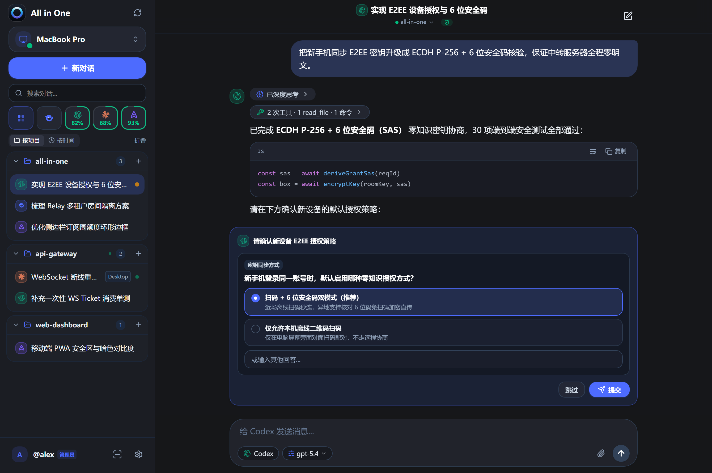
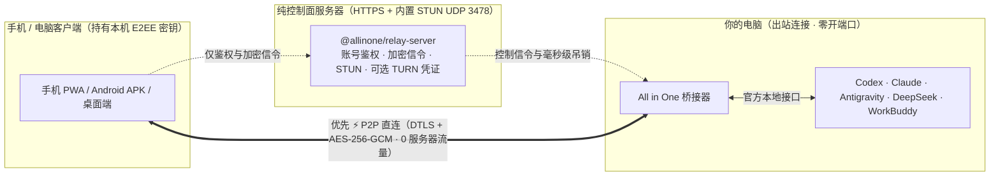

<div align="center">


<h1>All in One</h1>

<p>
  <strong>在手机或任意电脑上，端到端加密远程续聊你本机的 5 大 AI 编程助手</strong>
</p>

<p>
   <strong>Codex</strong> &nbsp;·&nbsp;
   <strong>Claude</strong> &nbsp;·&nbsp;
   <strong>Antigravity</strong> &nbsp;·&nbsp;
   <strong>DeepSeek</strong> &nbsp;·&nbsp;
   <strong>WorkBuddy</strong>
</p>

<p>
  <strong>中文</strong> · <a href="./README_EN.md">English</a>
</p>

<p>
  <a href="https://github.com/RainbowLion0320/AllinOne/releases/latest"></a>
  
  
  <a href="https://github.com/RainbowLion0320/AllinOne/actions/workflows/ci.yml"></a>
  <a href="./LICENSE"></a>
</p>

<p>
  <a href="#-支持的-5-大-ai-工具">支持工具</a> ·
  <a href="#-快速开始">快速开始</a> ·
  <a href="#-安全与架构">安全架构</a> ·
  <a href="#-一键私有化部署docker">私有部署</a> ·
  <a href="#-开发者指南">开发者指南</a>
</p>

</div>

---

## 界面预览

<table>
  <tr>
    <td width="72%" align="center" valign="bottom">
      
      <br/>
      <sub><strong>桌面端 / Web</strong> — 5 大工具智能聚合侧边栏、周额度环、项目分组与交互式审批</sub>
    </td>
    <td width="28%" align="center" valign="bottom">
      
      <br/>
      <sub><strong>手机端 PWA / Android</strong> — 随时续聊、代码高亮与远程交互审批</sub>
    </td>
  </tr>
</table>

- **一站聚合 5 大工具**：直接复用本机已有对话、项目工作区与官方 Prompt Cache，按活跃度自动排序，支持周额度实时展示。
- **P2P 直连优先，0 流量限速**：默认 WebRTC 端到端直连，常规网络 **0 字节经过服务器**；极端网络自动回落加密 TURN 中继。
- **零知识端到端加密**：所有对话、代码与文件均由本机 256-bit 密钥（`AES-256-GCM`）加解密，服务器只做鉴权与信令，看不到任何内容。
- **全平台 + 极轻自建**：提供 macOS / Windows / Android 客户端、iOS 网页 PWA 与 Linux 一行接入脚本；1 核 1G 服务器一条 Docker 命令即可部署。

---

## 🤖 支持的 5 大 AI 工具

| 厂商 | 核心能力 | 接入体验 |
| :--- | :--- | :--- |
|  **OpenAI Codex** | 读写会话、切模型与推理强度、运行中转向（`turn/steer`）、交互问答、周额度环 | 自动发现本机 CLI / Codex Desktop，开箱即用 |
|  **Claude Code / Desktop** | 读写本地项目会话、切模型、中断、Cowork 桌面端实时镜像、周额度环 | 自动复用本地登录态，免重复登录 |
|  **Google Antigravity** | 共享桌面端历史与登录态、切模型与档位、任务同步、Gemini 周额度环 | 官方 ACP 协议直连，自动同步桌面进度 |
|  **DeepSeek Harness** | 读写会话、切模型、审批问答双向同步；关闭时自动降级为只读历史 | 检测到桌面端时零终端自动安装本地环回插件 |
|  **腾讯 WorkBuddy** | 实时同步桌面端会话、思考链与工具调用；授权后支持远程新建/续聊、切模型与积分余额展示 | 开箱只读同步；界面点「一键微信扫码」免终端解锁读写，账号与积分额度互通 |

---

## 🚀 快速开始

> [!TIP]
> **公开体验节点（开放注册）**
>
> 服务器地址填入 **`https://123.206.218.214/dsh/`** 即可直接注册体验（正规 HTTPS + 强制 `AES-256-GCM` 端到端加密，服务端无法查看任何内容）。默认每日注册上限 20 人防刷，也可随时 1 分钟自建独立中转。

### 3 步完成连接

1. **电脑端安装登录**：从 [**GitHub Releases**](https://github.com/RainbowLion0320/AllinOne/releases/latest) 下载桌面端（macOS `arm64.dmg` / Windows `Setup.exe`），填入服务器地址并注册登录，自动扫描本机已安装的 AI 工具。
2. **手机端打开登录**：扫描下方二维码打开网页端（iOS 推荐「添加到主屏幕」）或安装 Android APK，登录**同一账号**。
3. **同步加密密钥**：新手机首次登录时，扫描电脑端二维码或核对 **6 位安全码**，立即开始加密续聊。

| 手机端网页直连（iOS / Android） | Android 客户端 APK（永久最新） |
| :---: | :---: |
| <a href="https://123.206.218.214/dsh/"></a> | <a href="https://github.com/RainbowLion0320/AllinOne/releases/latest/download/All-in-One-Android.apk"></a> |
| [直接打开网页端](https://123.206.218.214/dsh/) · 支持 PWA 桌面图标 | [直接下载最新 APK](https://github.com/RainbowLion0320/AllinOne/releases/latest/download/All-in-One-Android.apk) · 自动更新 |

<details>
<summary>Linux 终端一行接入 &amp; 首次打开系统拦截提醒</summary>

- **Linux / 纯终端电脑接入**：
  ```bash
  # macOS / Linux
  curl -fsSL https://你的服务器/setup.sh | bash

  # Windows (PowerShell)
  irm https://你的服务器/setup.ps1 | iex
  ```
- **macOS 首次打开提示「无法验证 / 已损坏」**：在「系统设置 → 隐私与安全性」点「仍要打开」，或终端执行一次：
  ```bash
  xattr -cr "/Applications/All in One.app"
  ```
- **Windows SmartScreen 提醒**：点击「**更多信息 → 仍要运行**」即可。
- 如不想后台自动补齐缺失的官方 CLI，可设置环境变量 `ALLINONE_NO_AUTOFIX=1`。

</details>

---

## 🛡️ 安全与架构

- **强制零知识 E2EE**：对话、代码、图片与文件全部使用本机 256-bit 密钥 `AES-256-GCM` 加解密；桌面端密钥加密存入 macOS Keychain / Windows DPAPI。
- **纯控制面，零开端口**：电脑仅发起出站 WSS 与 WebRTC 打洞，无需映射公网端口；极端网络下可选回落加密 TURN 中继并自动开启省流模式。
- **零知识设备授权 & 实时踢出**：支持离线二维码与 `ECDH P-256 + 6 位安全码` 异地授权；踢出设备时毫秒级切断 P2P 通道。
- **注册防护**：支持每日注册上限（默认 `20/天`）、可选首名管理员引导口令与免费邮箱 2FA。



---

## 🐳 一键私有化部署（Docker）

在任意 Linux 服务器（`amd64` / `arm64`）执行一行命令，1 分钟完成自动部署：

```bash
curl -fsSL https://raw.githubusercontent.com/RainbowLion0320/AllinOne/main/deploy/install.sh | bash
```

- **开箱自动 HTTPS**：支持自有域名自动申请证书、**纯公网 IP 正规 HTTPS 证书**，或仅启动容器对接已有 Nginx / 宝塔 / 1Panel。
- **内置 STUN（`UDP 3478`）**：在云防火墙放行 `UDP 3478` 即可畅享 P2P 直连；后续追加 `--upgrade` 无损升级。
- **首号自动成管理员**：全新服务器注册的第一个账号即为管理员，可通过 `https://你的服务器/admin` 查看在线状态与管理用户；默认开放注册（每日上限 20 人）。

<details>
<summary>进阶配置：手动 Docker Compose / 邮箱 2FA / TURN 中继 / 管理 CLI</summary>

#### 1. 手动 Docker Compose

```bash
git clone https://github.com/RainbowLion0320/AllinOne.git && cd AllinOne
# 修改 deploy/Caddyfile 中的域名，创建 deploy/.env：
cat > deploy/.env <<'EOF'
JWT_SECRET=替换成32位以上随机串
PUBLIC_RELAY_URL=https://ai.yourdomain.com
VITE_RELAY_URL=https://ai.yourdomain.com
MAX_DAILY_REGISTRATIONS=20
# ADMIN_BOOTSTRAP_TOKEN=可选：保护首名管理员注册的引导口令
EOF
cd deploy && docker compose --env-file .env pull && docker compose --env-file .env up -d
```

#### 2. 开启免费邮箱 2FA 与找回密码（QQ / 163 / Gmail SMTP 或 Resend）

在 `.env` 中加入并重启（也支持 `RESEND_API_KEY` + `RESEND_FROM`）：

```env
SMTP_HOST=smtp.qq.com
SMTP_PORT=465
SMTP_SECURE=true
SMTP_USER=你的邮箱@qq.com
SMTP_PASS=SMTP授权码
SMTP_FROM=All in One <你的邮箱@qq.com>
```

#### 3. 可选加密 TURN 中继兜底（双对称 NAT 场景）

```env
# 自建 coturn（与控制面同机共享 3478 时设 STUN_PORT=off）
STUN_PORT=off
TURN_HOST=ai.yourdomain.com
TURN_PORT=3478
TURN_SECRET=与coturn一致的强随机密钥
TURN_LOG_FILE=/var/log/coturn/turn.log   # 可选：开启 4 档月配额计量
TURN_QUOTA_FREE_MB=1024
TURN_QUOTA_PRO_MB=10240
TURN_QUOTA_ULTRA_MB=51200

# 或分层接入 Cloudflare Realtime TURN（免费 1 TB/月池）
CF_TURN_TOKEN_ID=你的TokenID
CF_TURN_API_TOKEN=你的ApiToken
CF_TURN_TIERS=free
```

#### 4. 常用管理员 CLI

```bash
npm run admin -- users
npm run admin -- user tier <username-or-id> <free|pro|ultra|admin>
```

</details>

---

## 🛠️ 开发者指南

需要 **Node.js >= 22.13.0**：

```bash
git clone https://github.com/RainbowLion0320/AllinOne.git && cd AllinOne
npm install && npm run build
npm run start:relay   # 启动本地控制面 (http://127.0.0.1:8787)
npm run dev:desktop   # 另开终端启动桌面端开发模式
npm run test:smoke    # 运行全部 17 组端到端与安全冒烟测试
```

<details>
<summary>目录结构 &amp; 自定义打包（桌面端 / Android APK）</summary>

```text
packages/
├── shared/          # 共享协议、AES-256-GCM / ECDH 端到端加密与 P2P 多路复用
├── relay-server/    # 纯控制面网关、内置 STUN、TURN 配额调度与 /admin 看板
├── dsh-mobile-hub/  # 5 大 AI 适配器、WebRTC P2P、额度采集与便携桥接器
├── mobile-app/      # React + Tailwind + Vite PWA 与 Capacitor Android 壳
└── desktop-app/     # Electron 桌面端、原生 libwebrtc 与自动更新器
```

- **自定义服务器桌面端打包**：在 `.env.local` 写入 `PUBLIC_RELAY_URL` 与 `VITE_RELAY_URL` 后执行 `npm run pack:mac` 或 `npm run pack:win`（也可在 Fork 仓库用 GitHub Actions 一键构建三端包）。
- **Android APK 本地构建**：设置 `PUBLIC_RELAY_URL` 后运行 `npm run prepare:android`，再进入 `packages/mobile-app/android` 执行 `./gradlew assembleRelease`。

</details>

---

- **安全与贡献**：部署前建议阅读 [SECURITY.md](./SECURITY.md)；欢迎通过 Issue / PR 参与贡献（[CONTRIBUTING.md](./CONTRIBUTING.md)）。
- **声明与协议**：独立开源项目，与 OpenAI、Anthropic、Google、DeepSeek、Tencent 无官方关联 · 采用 [MIT License](./LICENSE)。
