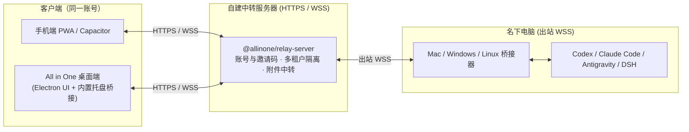

# All in One

<p align="center">
  <strong>中文</strong> · <a href="./README_EN.md">English</a>
</p>

<p align="center">
  <a href="https://github.com/RainbowLion0320/AllinOne/releases/latest"></a>
  <a href="./LICENSE"></a>
  
  <a href="https://github.com/RainbowLion0320/AllinOne/actions/workflows/ci.yml"></a>
</p>

在手机和其他电脑上，远程续聊你本机的 **Codex / Claude Code / Antigravity / DeepSeek Harness** 对话。

它在你自己的服务器上运行一个轻量中转，直接调用各 AI 工具的本地官方接口，延续本机项目工作区、历史会话与 Prompt Cache。用同一账号在多台设备登录后，自动发现并随时切换操控。

---

## 快速开始

### 1. 安装客户端（已有服务器地址和邀请码）

#### 电脑端

1. 前往 [**GitHub Releases**](https://github.com/RainbowLion0320/AllinOne/releases/latest) 下载并安装：
   - **macOS (Apple Silicon)**：`All.in.One-*-arm64.dmg`
   - **Windows (x64)**：`All.in.One.Setup.*.exe`
2. 打开 **All in One**，填入服务器地址，用邀请码注册或直接登录。
3. 登录后会自动把这台电脑绑定到你的账号、在系统托盘保持后台连接，并识别本机已有的 AI 编程工具（若已装桌面端但缺对应 CLI，后台会自动补齐）。

> [!NOTE]
> **首次打开系统拦截提醒（开源安装包未购商业公证证书）：**
> - **macOS**：安装后首次打开若提示「无法验证」或「已损坏，无法打开」，请先点「取消」，在「系统设置 → 隐私与安全性」点「仍要打开」；若仍提示已损坏，在终端运行一次：
>   ```bash
>   xattr -cr "/Applications/All in One.app"
>   ```
> - **Windows**：若弹出 SmartScreen「Windows 已保护你的电脑」，点击「更多信息 → 仍要运行」即可。

Linux 或纯终端环境可直接运行一行命令接入：
- macOS / Linux：`curl -fsSL https://你的服务器/setup.sh | bash`
- Windows (PowerShell)：`irm https://你的服务器/setup.ps1 | iex`

#### 手机端

| 手机端网页直连（iOS / Android 通用） | Android 客户端 APK（永久最新） |
| :---: | :---: |
| <a href="https://123.206.218.214/dsh/"></a> | <a href="https://github.com/RainbowLion0320/AllinOne/releases/latest/download/All-in-One-Android.apk"></a> |
| [直接打开网页端](https://123.206.218.214/dsh/) | [直接下载最新 APK](https://github.com/RainbowLion0320/AllinOne/releases/latest/download/All-in-One-Android.apk) |

- **iOS / 通用网页**：手机扫码或直接打开网页端，点「**添加到主屏幕**」即可作为 App 使用；登录同一账号后自动列出名下全部在线电脑。
- **Android**：手机扫码下载安装 `All-in-One-Android.apk`（自动热更新最新界面），也可前往 [**GitHub Releases**](https://github.com/RainbowLion0320/AllinOne/releases/latest) 下载。

---

### 2. 自建中转服务器（Docker）

All in One 部署在你自己的 Linux 服务器上：

```bash
# 1. 拉取代码
git clone https://github.com/RainbowLion0320/AllinOne.git
cd AllinOne

# 2. 把 deploy/Caddyfile 中的 ai.yourdomain.com 改为你的域名（DNS 已指向本机）

# 3. 创建 deploy/.env，填入你的随机密钥
cat > deploy/.env <<'EOF'
JWT_SECRET=替换成32位以上随机串
PUBLIC_RELAY_URL=https://ai.yourdomain.com
VITE_RELAY_URL=https://ai.yourdomain.com
EOF

# 4. 构建并启动（内置 Caddy 自动签发 HTTPS 证书）
cd deploy
docker compose --env-file .env up -d --build

# 5. 生成首个管理员邀请码
docker exec allinone-relay node packages/relay-server/src/admin-cli.js invite create --count 1 --admin --note "owner"
docker compose restart allinone-relay
```

接着按上面的 **「1. 安装客户端」** 注册你的管理员账号。之后可以直接在客户端的「邀请码管理」里随时生成和作废一次性邀请码，或访问 **`https://你的服务器/admin`**（也可在客户端「设置 → 服务器监控看板」直达）按需查看全服用户在线状态、电脑桥接、终端连接与服务器资源快照（零额外进程与后台轮询消耗）。

<details>
<summary>可选：开启免费邮箱绑定与自助找回密码（QQ / 163 / Gmail SMTP）</summary>

在 `deploy/.env`（或 `packages/relay-server/.env`）中补充任意免费邮箱的 SMTP 授权码并重启中转服务，即可开启注册选填邮箱、邮箱登录、账号补绑/换绑邮箱及「忘记密码」重置：

```env
SMTP_HOST=smtp.qq.com
SMTP_PORT=465
SMTP_SECURE=true
SMTP_USER=你的邮箱@qq.com
SMTP_PASS=邮箱设置里生成的SMTP授权码
SMTP_FROM=All in One <你的邮箱@qq.com>
```

> 也可使用 `RESEND_API_KEY` + `RESEND_FROM` 通过 Resend HTTPS API 发送；未配置时自动以用户名 + 密码 + 邀请码模式运行。

</details>

<details>
<summary>常用管理命令</summary>

```bash
npm run admin -- invite create --count 3 --note "给朋友"
npm run admin -- invite list
npm run admin -- invite revoke INV-XXXX-XXXX
npm run admin -- users
```

</details>

---

## 支持的工具与能力

| 工具 | 接入方式 | 支持能力 | 说明 |
| :--- | :--- | :--- | :--- |
| **Codex** | `codex app-server --stdio` | 读写会话、切模型与推理强度、中断 | 自动探测 PATH 及 macOS `ChatGPT.app` 内置 CLI |
| **Claude Code** | `claude -p --resume --output-format stream-json` | 读写 `~/.claude/projects/` 会话、切模型、中断 | 自动复用本地登录态 |
| **Antigravity** | `agy acp --app-data-dir antigravity` | 共享桌面端历史与登录态、切模型与档位、后台任务同步 | 桌面端进度自动同步到 All in One；远程改写同一对话后，切回原生 `Antigravity.app` 续聊前请先重启一次桌面端 |
| **DeepSeek Harness** | 原生 Cordis 插件 (`dsh-mobile-hub`) | 挂载插件后支持读写与切模型；独立运行时支持只读历史 | 挂载方式见下方开发者指南 |

- **跨设备互联**：手机和电脑登录同一账号即可互控名下所有在线电脑，随时切换。
- **零知识端到端加密（E2EE）**：电脑端自动生成随机 256-bit 密钥（存于系统钥匙串 / DPAPI），所有对话、代码、附件与本地图片均经 `AES-256-GCM` 端到端加密后通过中转服务器盲转发；新手机通过本地离线二维码扫码同步密钥，中转服务器无法查看或伪造任何内容。
- **一次性邀请码**：管理员按需签发 `INV-XXXX-XXXX` 邀请码，一码一人，账号间数据与设备完全隔离。
- **直连原生会话**：直接通过各工具官方接口读写本地数据，延续原有的对话上下文与 Prompt Cache。

---

## 架构概览



---

## 开发者指南

> 源码运行与打包需要 **Node.js >= 22.13.0**。

<details>
<summary>1. 本地联调</summary>

```bash
git clone https://github.com/RainbowLion0320/AllinOne.git
cd AllinOne
npm install
npm run build

# 生成管理员邀请码并启动本地中转服务 (http://127.0.0.1:8787)
npm run admin -- invite create --count 1 --admin --note "dev"
npm run start:relay

# 新开终端启动 Electron 桌面端开发模式
npm run dev:desktop
```

</details>

<details>
<summary>2. 打包预置了专属服务器地址的桌面安装包 (.dmg / .exe)</summary>

```bash
cat > .env.local <<'EOF'
PUBLIC_RELAY_URL=https://ai.yourdomain.com
VITE_RELAY_URL=https://ai.yourdomain.com
EOF

npm run pack:mac   # 输出 packages/desktop-app/release/*.dmg
npm run pack:win   # 输出 packages/desktop-app/release/*.exe（在 Windows 运行）
```

也可以在你 Fork 的仓库里通过 **Actions → Build Desktop Installers → Run workflow** 填入 `relay_url`，由 GitHub Actions 自动产出双端安装包。

</details>

<details>
<summary>3. Capacitor 手机壳、DeepSeek Harness 插件与环境变量</summary>

- **Capacitor 手机壳**：将 `packages/mobile-app/capacitor.config.json` 中的 `server.url` 改为你的 HTTPS 地址后执行：
  ```bash
  cd packages/mobile-app
  npm run build
  npx cap sync android   # 或 ios
  npx cap open android
  ```
- **DeepSeek Harness 插件模式**：复制 `packages/dsh-mobile-hub/cordis.patch.example.yml` 为 `cordis.patch.yml` 并填入配置，在 `~/.dsh/profiles/desktop/package.json` 链接 `dsh-mobile-hub` 并加入 `dsh.profile.bundles`，重启 DSH 生效。
- **关闭后台自动补装 CLI**：设置环境变量 `ALLINONE_NO_AUTOFIX=1`。

</details>

<details>
<summary>4. 目录结构与冒烟测试</summary>

```text
AllinOne/
├── packages/
│   ├── shared/          # RPC / Event 协议与路径校验
│   ├── relay-server/    # 中转网关、账号邀请码与静态托管
│   ├── dsh-mobile-hub/  # 4 大 AI 适配器、环境补齐与单文件桥接 CLI
│   ├── mobile-app/      # React + Tailwind + PWA 前端
│   └── desktop-app/     # Electron 桌面客户端与安装包构建
├── deploy/              # Dockerfile / docker-compose.yml / Caddyfile / nginx.conf
├── scripts/             # 桥接打包器与端到端冒烟测试
└── .github/workflows/   # CI 测试与桌面端发版工作流
```

运行端到端冒烟与安全测试：
```bash
npm run test:smoke
```

</details>

---

## 安全说明、贡献与协议

部署前建议阅读 [SECURITY.md](./SECURITY.md)：

- **仅连接自己部署的 HTTPS/WSS 中转**：传输层使用 TLS 加密，中转服务负责路由消息与临时附件，请只在受信任的自建服务器上使用。
- **权限配置**：适配器默认以自动审批/编辑模式运行以方便远程操作，可按 [SECURITY.md](./SECURITY.md) 中的说明收紧权限。
- **声明**：本项目为独立开源工具，与 DeepSeek、OpenAI、Anthropic、Google 无官方关联。
- **贡献与协议**：欢迎提 Issue / PR（见 [CONTRIBUTING.md](./CONTRIBUTING.md)），采用 [MIT License](./LICENSE)。
