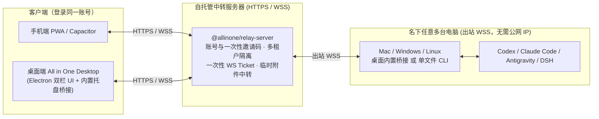

# All in One · 跨设备 AI 编程助手远程总控

<p align="center">
  <strong>中文</strong> · <a href="./README_EN.md">English</a>
</p>

<p align="center">
  <a href="https://github.com/RainbowLion0320/AllinOne/releases/latest"></a>
  <a href="./LICENSE"></a>
  
  <a href="https://github.com/RainbowLion0320/AllinOne/actions/workflows/ci.yml"></a>
</p>

**All in One** 是一套**傻瓜式安装、自托管、零侵入、0 额外 Token 消耗**的跨设备 AI 编程助手控台。

只要在你的任意多台电脑和手机上登录同一个账号，就能随时在手机或另一台电脑上**原位续聊**本机的 **Codex / Claude Code / Antigravity / DeepSeek Harness** 全部对话，直接复用本机项目工作区与官方 Prompt Cache。

---

## 一、傻瓜式安装（一步到位，无需配环境）

### 场景 A：已有服务器地址和邀请码（普通用户 · 1 分钟上手）

**完全不需要安装 Node.js、不需要克隆代码、不需要敲命令行：**

1. **安装电脑端（推荐一步到位安装包）**
   - 前往 [**GitHub Releases**](https://github.com/RainbowLion0320/AllinOne/releases/latest) 下载对应系统的安装包：
     - **macOS (Apple Silicon)**：`All in One-*-arm64.dmg`（拖入「应用程序」即可）
     - **Windows (x64)**：`All in One Setup *.exe`（双击下一步安装）
   - 打开 **All in One** → 填入服务器地址 → 用邀请码注册或直接登录账号。
   - 登录后会自动完成以下全部工作：
     - 自动把当前电脑绑定到你的账号并启动内置后台桥接（关掉窗口也会常驻顶部菜单栏/系统托盘，手机端 24 小时可连）；
     - 自动扫描本机已安装的 **Codex / Claude Code / Antigravity / DeepSeek Harness**；
     - **半成品环境自动补齐**：若检测到你装了某款 AI 桌面应用或已有本地会话记录，但缺少对应官方 CLI（例如 macOS 装了 `Antigravity.app` 但没装 `agy` CLI），会在后台静默自动补装并热刷新就绪，无需手动折腾（未使用的工具绝不乱装）。
   - *纯终端 / Linux 电脑也支持 1 行命令接入*：
     - macOS / Linux：`curl -fsSL https://你的服务器/setup.sh | bash`
     - Windows (PowerShell)：`irm https://你的服务器/setup.ps1 | iex`

2. **连接手机端（免安装 App，iOS / Android 通用）**
   - 用手机浏览器打开你的服务器地址（或服主发给你的邀请注册链接）→ 点击「**添加到主屏幕**」即可像原生 App 一样使用。
   - 登录同一个账号后，手机端会自动发现并列出你名下所有在线电脑，随时一键切换操控。

> macOS 首次打开未签名 `.dmg` 若提示「无法验证开发者」，在「系统设置 → 隐私与安全性」点击「仍要打开」，或右键 App 点「打开」即可。

---

### 场景 B：首次自建中转服务器（服主 · Docker 3 分钟上线）

因为本项目为隐私优先的**纯自托管**架构，你需要在一台自己的 Linux 服务器上启动中转网关（内置 HTTPS 自动续期）：

```bash
# 1. 拉取代码
git clone https://github.com/RainbowLion0320/AllinOne.git
cd AllinOne

# 2. 将 deploy/Caddyfile 中的 ai.yourdomain.com 改为你的真实域名（DNS A 记录指向本服务器）

# 3. 写入 deploy/.env（务必使用高强度随机密钥，切勿提交到 Git）
cat > deploy/.env <<'EOF'
CLIENT_ACCESS_TOKEN=请替换为至少16位高强度管理员密钥
BRIDGE_SECRET=请替换为至少16位高强度桥接密钥
JWT_SECRET=请替换为32位以上随机串
PUBLIC_RELAY_URL=https://ai.yourdomain.com
VITE_RELAY_URL=https://ai.yourdomain.com
EOF

# 4. 一键构建并启动（自动构建前端 PWA、便携桥接包并申请 HTTPS 证书）
cd deploy
docker compose --env-file .env up -d --build

# 5. 生成你的首个管理员一次性邀请码（仅首次需要）
docker exec allinone-relay node packages/relay-server/src/admin-cli.js invite create --count 1 --admin --note "owner"
docker compose restart allinone-relay
```

完成以上 5 步后，直接回到上方 **[场景 A](#场景-a已有服务器地址和邀请码普通用户--1-分钟上手)** 下载桌面端或打开 `https://ai.yourdomain.com`，用刚才的邀请码注册你的管理员账号即可！后续给朋友发一次性邀请码直接在 App 里的「邀请码管理」一键生成，**不用再登服务器**。

<details>
<summary>服主常用管理命令（生成/查看/作废邀请码、查看用户）</summary>

```bash
# 生成 3 个普通一次性邀请码
npm run admin -- invite create --count 3 --note "给朋友"

# 查看所有邀请码状态
npm run admin -- invite list

# 作废未使用的邀请码
npm run admin -- invite revoke INV-XXXX-XXXX

# 查看已注册账号及绑定电脑数
npm run admin -- users
```

</details>

---

## 二、核心特性与支持的 4 大 AI 工具

- **零侵入纯桥接 · 0 额外 Token**：不改写提示词、不注入冗余上下文，直接通过各工具官方本地协议/CLI 读写原生会话，手机与电脑无缝接力。
- **跨设备双向互联**：不仅手机控电脑，装了桌面端的 Mac / Windows 之间也可以互控彼此名下的所有电脑。
- **账号 + 严格一次性邀请码**：每人独立房间与凭证哈希落盘，跨账号完全不可见；多台电脑登录同一账号自动汇聚，一键切换。
- **4 大主流 AI 编程工具原生接入**：

  | 工具 | 官方原生接入方式 | 核心能力 | 跨端同步说明 |
  | :--- | :--- | :--- | :--- |
  | **Codex** | `codex app-server --stdio`（读写分离双进程，每轮自动释放写锁） | 全量读写、模型与推理强度切换、中断 | 自动探测 PATH / macOS `ChatGPT.app` 内置 CLI，双端随时互切 |
  | **Claude Code** | `claude -p --resume --output-format stream-json` | 全量读写 `~/.claude/projects/`、模型切换、中断 | 双端随时互切，半成品自动补装 CLI |
  | **Antigravity** | `agy acp --app-data-dir antigravity` 热保活会话池 + 实时磁盘监听 | 与桌面端共享登录态与会话历史、11 组模型与思考档位切换、长任务后台续跑 | 桌面端 → All in One 秒级实时自动同步；若在 All in One 续聊了桌面端已打开的同一对话，切回 `Antigravity.app` 前请先重启一次桌面端以重载磁盘 |
  | **DeepSeek Harness** | 原生 Cordis 插件 (`dsh-mobile-hub`) / 本地只读历史 | 挂载插件后全量读写与模型切换；独立桥接下自动只读历史 | 挂载插件后共享进程内状态，零延迟 |

---

## 三、系统架构



---

## 四、开发者指南（源码构建与二次开发）

> 本地开发与源码打包要求：**Node.js >= 22.13.0**

<details>
<summary>1. 本地 3 分钟开发联调</summary>

```bash
git clone https://github.com/RainbowLion0320/AllinOne.git
cd AllinOne
npm install
npm run build

# 生成首个管理员邀请码并启动本地中转服务 (http://127.0.0.1:8787)
npm run admin -- invite create --count 1 --admin --note "dev"
npm run start:relay

# 新开终端运行 Electron 桌面端开发模式（自带双栏 UI 与内置本机桥接）
npm run dev:desktop
```

</details>

<details>
<summary>2. 自行打包预置了你专属服务器地址的桌面安装包 (.dmg / .exe)</summary>

如果你想给团队/朋友分发**打开就默认填好你服务器地址**的定制安装包：

```bash
cat > .env.local <<'EOF'
PUBLIC_RELAY_URL=https://ai.yourdomain.com
VITE_RELAY_URL=https://ai.yourdomain.com
EOF

npm run pack:mac   # 输出 macOS arm64 .dmg -> packages/desktop-app/release/
npm run pack:win   # 输出 Windows x64 .exe（在 Windows 下运行）
```

> 也可以直接在自己 Fork 后的仓库 **Actions → Build Desktop Installers → Run workflow** 里填入 `relay_url`，让 GitHub Actions 云端自动打好 macOS + Windows 双端安装包。

</details>

<details>
<summary>3. 编译 Capacitor 原生 Android / iOS 壳 & 挂载 DeepSeek Harness 插件</summary>

- **Capacitor 原生手机壳（可选）**：修改 `packages/mobile-app/capacitor.config.json` 中的 `server.url` 为你的 HTTPS 域名后运行：
  ```bash
  cd packages/mobile-app
  npm run build
  npx cap sync android   # 或 ios
  npx cap open android
  ```
- **DeepSeek Harness 插件模式（开启 DSH 写权限）**：
  1. 复制 `packages/dsh-mobile-hub/cordis.patch.example.yml` 为 `packages/dsh-mobile-hub/cordis.patch.yml`（已被 `.gitignore` 忽略），填入 `relayUrl` 与密钥配置。
  2. 在 `~/.dsh/profiles/desktop/package.json` 的 `dependencies` 链接 `dsh-mobile-hub` 并加入 `dsh.profile.bundles`，重启 DSH 即可。
- **关闭后台自动补装半成品 CLI**：设置环境变量 `ALLINONE_NO_AUTOFIX=1`。

</details>

<details>
<summary>4. 仓库目录结构与端到端冒烟测试</summary>

```text
AllinOne/
├── packages/
│   ├── shared/          # 统一 RPC / Event 协议与安全校验
│   ├── relay-server/    # 自建中转网关（HTTPS/WSS + 账号/邀请码 + 多租户隔离 + 静态托管）
│   ├── dsh-mobile-hub/  # 本机桥接引擎（4 大 AI 适配器 + 自动环境补齐 + 单文件 CLI）
│   ├── mobile-app/      # 响应式前端（React + Tailwind + PWA + Capacitor）
│   └── desktop-app/     # Electron 桌面总控客户端（内置桥接 + 托盘 + DMG/NSIS 打包）
├── deploy/              # Dockerfile / docker-compose.yml / Caddyfile / nginx.conf
├── scripts/             # 单文件桥接打包器与 11 项端到端冒烟测试
└── .github/workflows/   # CI 自动构建测试 & 桌面端自动发版工作流
```

运行全部 11 项端到端冒烟与安全测试：
```bash
npm run test:smoke
```

</details>

---

## 五、安全模型、贡献与协议

在部署或使用前，请阅读完整的 [SECURITY.md](./SECURITY.md)：

1. **必须自托管 + HTTPS/WSS**：通信走 TLS 加密，中转服务器负责路由消息和临时附件（非零知识 E2EE），**切勿将本机桥接连接到陌生人部署的第三方服务器**。
2. **默认高权限自动执行**：为保证远程编程流畅度，适配器默认以自动审批/编辑模式驱动本机 AI，可在配置中按需收紧权限（详见 [SECURITY.md](./SECURITY.md)）。
3. **独立开源声明**：本项目为社区独立开源工具，与 DeepSeek、OpenAI、Anthropic、Google 无任何官方隶属或授权关系。
4. **贡献 & 协议**：欢迎提 Issue / PR（见 [CONTRIBUTING.md](./CONTRIBUTING.md)），基于 [MIT License](./LICENSE) 开源。
