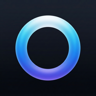
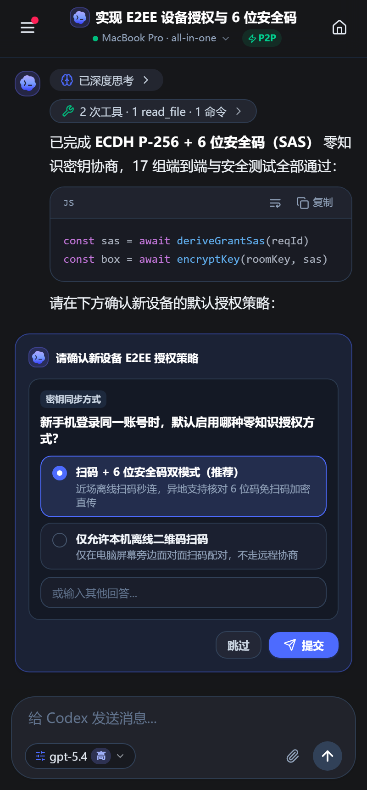
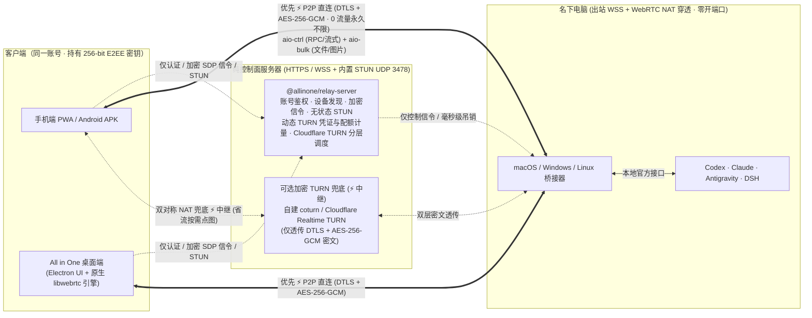

<div align="center">



<h1>All in One</h1>

<p>
  <strong>在手机或任意电脑上，端到端加密远程续聊你本机的 AI 编程对话</strong><br/>
  统一接入 <strong>Codex</strong> · <strong>Claude Code / Desktop</strong> · <strong>Antigravity</strong> · <strong>DeepSeek Harness</strong>
</p>

<p>
  <strong>中文</strong> · <a href="./README_EN.md">English</a>
</p>

<p>
  <a href="https://github.com/RainbowLion0320/AllinOne/releases/latest"></a>
  
  
  <a href="https://github.com/RainbowLion0320/AllinOne/actions/workflows/ci.yml"></a>
  <a href="./LICENSE"></a>
</p>

<p>
  <a href="#-核心亮点">核心亮点</a> ·
  <a href="#-快速开始">快速开始</a> ·
  <a href="#-支持的工具与能力">支持工具</a> ·
  <a href="#-安全与架构">安全与架构</a> ·
  <a href="#-一键私有化部署docker">一键部署</a> ·
  <a href="#-开发者指南">开发者指南</a>
</p>

</div>

---

## 界面预览

<table>
  <tr>
    <td width="72%" align="center" valign="bottom">
      
      <br/>
      <sub><strong>桌面端 / Web</strong> — 四大工具聚合侧边栏、边框集成周额度环、项目分组与交互式问答卡片</sub>
    </td>
    <td width="28%" align="center" valign="bottom">
      
      <br/>
      <sub><strong>手机端 PWA / Android</strong> — 随时续聊、代码高亮与远程交互审批</sub>
    </td>
  </tr>
</table>

> All in One 采用 **纯控制面 + WebRTC P2P 直连优先（`AIO-P2P v1`）+ 可选加密 TURN 兜底** 架构：服务器仅负责账号认证、设备发现、加密信令交换与内置无状态 STUN（`UDP 3478`），不经手明文业务数据也无文件暂存。常规网络下手机与电脑通过 **`⚡ P2P` 端到端直连（0 字节经过服务器、永久不限流）**；双对称 NAT 等极端网络下可无缝自动回落至加密 **`⚡ 中继`**（自建 `coturn` 或分层 Cloudflare Realtime TURN，依然为 DTLS + AES-256-GCM 双层密文透传），同时 100% 延续原有项目工作区、本地历史会话与官方 Prompt Cache。

---

## ✨ 核心亮点

<table>
  <tr>
    <td width="50%" valign="top">
      <h4>🧩 四大 AI 编程工具一站聚合</h4>
      <p>统一管理本机的 <strong>Codex</strong>、<strong>Claude Code / Desktop</strong>、<strong>Antigravity</strong> 与 <strong>DeepSeek Harness</strong>，按项目或时间分组，一个入口续聊所有对话。</p>
    </td>
    <td width="50%" valign="top">
      <h4>⚡ WebRTC P2P 直连优先 + 可选加密 TURN 兜底</h4>
      <p>默认 <strong><code>⚡ P2P</code> 端到端直连</strong>（<code>AES-256-GCM</code> + DTLS 双层加密，<strong>0 字节经过服务器、永久不限流</strong>），内置 RFC 5389 STUN（<code>UDP 3478</code>）；双对称 NAT 下自动回落加密 <strong><code>⚡ 中继</code></strong>（可选自建 <code>coturn</code> + 4 档月配额，或分层接入 Cloudflare Realtime TURN 免费 1 TB/月池），中继模式自动开启<strong>省流量按需加载图片</strong>。</p>
    </td>
  </tr>
  <tr>
    <td width="50%" valign="top">
      <h4>🔒 强制零知识端到端加密（E2EE）</h4>
      <p>包括 WebRTC 信令、RPC 指令、流式输出与二进制文件均使用本机 256-bit 房间密钥端到端加解密；支持离线二维码扫码与 <strong>ECDH P-256 + 6 位安全码</strong>免扫码授权。</p>
    </td>
    <td width="50%" valign="top">
      <h4>📊 交互式问答、双向同步与周额度环</h4>
      <p>原生渲染工具提问与审批卡片（支持 Codex <code>turn/steer</code> 与 DSH 双向消卡），侧边栏图标边框集成顺时针进度环实时展示 Codex / Claude / Antigravity 剩余周额度。</p>
    </td>
  </tr>
  <tr>
    <td width="50%" valign="top">
      <h4>📱 全平台多设备无缝切换</h4>
      <p>提供 macOS / Windows 桌面端（原生 Chromium <code>libwebrtc</code> 引擎 + 托盘常驻）、Linux 纯 JS 一行接入脚本、iOS / Android 网页 PWA 与 Android 原生壳 APK。</p>
    </td>
    <td width="50%" valign="top">
      <h4>🐳 极轻自建，1 核 1G 即可稳跑</h4>
      <p>控制面无业务数据中转与临时文件存储，单条 <code>docker compose</code> 命令即可在自有 VPS 启动（自动 HTTPS + 内置 STUN，可选接 <code>coturn</code> / Cloudflare TURN），附带零空载 <code>/admin</code> 监控看板，MIT 完全开源。</p>
    </td>
  </tr>
</table>

---

## 🚀 快速开始

> [!TIP]
> **公开体验邀请码（一码一人，先到先得）**
>
> 想先直接体验？打开下方网页端或客户端，服务器地址填入 **`https://123.206.218.214/dsh/`**（正规 Let's Encrypt HTTPS + 强制零知识 `AES-256-GCM` 端到端加密，中转服务器无法查看你的任何对话、代码与文件），任选以下一个邀请码注册即可：
>
> | 邀请码 1 | 邀请码 2 | 邀请码 3 | 邀请码 4 | 邀请码 5 |
> | :---: | :---: | :---: | :---: | :---: |
> | `INV-KXRR-6BNB` | `INV-DCMM-3WFY` | `INV-AFCC-SX2F` | `INV-NUER-YGDK` | `INV-3HXE-UGEK` |
>
> 如已被领完，可按下方 [一键私有化部署](#-一键私有化部署docker) 1 分钟拥有独立私有中转，或提 Issue 留言获取新码。

### 3 步完成首次连接

1. **电脑端安装登录**：在需要被远程操控的电脑上安装桌面端（或运行终端一行脚本），填入服务器地址并用邀请码注册 / 登录，自动绑定电脑并在托盘常驻。
2. **手机端打开登录**：扫码打开网页端（iOS 可「添加到主屏幕」）或安装 Android APK，登录**同一账号**即可看到名下所有在线电脑。
3. **同步 E2EE 密钥**：首次使用新手机时，扫描电脑端离线二维码或核对 **6 位安全码**完成零知识密钥授权，立即开始加密续聊。

### 电脑端下载

前往 [**GitHub Releases**](https://github.com/RainbowLion0320/AllinOne/releases/latest) 下载对应安装包：

- **macOS (Apple Silicon)**：`All.in.One-*-arm64.dmg`
- **Windows (x64)**：`All.in.One.Setup.*.exe`

登录后会自动识别本机已有的 AI 编程工具（若已装桌面端但缺少对应官方 CLI，后台会自动补齐；设 `ALLINONE_NO_AUTOFIX=1` 可关闭）。

<details>
<summary>首次打开 macOS / Windows 系统拦截提醒（开源安装包未购商业公证证书）</summary>

- **macOS**：首次打开若提示「无法验证」或「已损坏，无法打开」，请先点「取消」，前往「系统设置 → 隐私与安全性」点击「仍要打开」；若仍提示已损坏，在终端运行一次：
  ```bash
  xattr -cr "/Applications/All in One.app"
  ```
- **Windows**：若弹出 SmartScreen「Windows 已保护你的电脑」，点击「**更多信息 → 仍要运行**」即可。

</details>

Linux 或纯终端环境可直接运行一行命令接入：

```bash
# macOS / Linux
curl -fsSL https://你的服务器/setup.sh | bash

# Windows (PowerShell)
irm https://你的服务器/setup.ps1 | iex
```

### 手机端扫码直连

| 手机端网页直连（iOS / Android 通用） | Android 客户端 APK（永久最新） |
| :---: | :---: |
| <a href="https://123.206.218.214/dsh/"></a> | <a href="https://github.com/RainbowLion0320/AllinOne/releases/latest/download/All-in-One-Android.apk"></a> |
| [直接打开网页端](https://123.206.218.214/dsh/) · iOS 推荐「添加到主屏幕」 | [直接下载最新 APK](https://github.com/RainbowLion0320/AllinOne/releases/latest/download/All-in-One-Android.apk) · 自动热更新界面 |

---

## 🤖 支持的工具与能力

| 工具 | 本地接入方式 | 核心能力 | 亮点与说明 |
| :--- | :--- | :--- | :--- |
| **Codex** | `codex app-server --stdio` | 读写会话、切模型与推理强度、异步问答、运行中转向（`turn/steer`）、中断 | 自动探测 `PATH`、macOS `ChatGPT.app` 及 Windows Codex Desktop 最新内置 CLI；支持周额度环形展示 |
| **Claude Code / Desktop** | `claude -p --resume --output-format stream-json` | 读写 `~/.claude/projects/` 会话、切模型、中断、Cowork/Code 桌面端镜像 | 自动复用本地登录态；桌面端 Cowork 会话附带 `Desktop` 徽章实时同步；支持周额度展示 |
| **Antigravity** | `agy acp --app-data-dir antigravity` | 共享桌面端历史与登录态、切模型与档位、后台任务同步 | 桌面端进度自动同步；支持 Gemini 周额度环形展示；远程续写同一会话后，切回原生桌面端前请先重启一次 `Antigravity.app` |
| **DeepSeek Harness** | 自动安装本地环回 IPC (`allinone-dsh-ipc`) / 原生插件 (`dsh-mobile-hub`) | 读写会话、切模型、交互问答双向同步；未运行时自动降级为只读历史 | 检测到 `~/.dsh/profiles/desktop` 时零终端自动安装本地环回 IPC（`127.0.0.1` + 256-bit Token）；手机端回答后桌面端卡片自动静默关闭 |

---

## 🛡️ 安全与架构

All in One 从协议层设计为 **六道零知识纵深防御**，即使中转服务器被攻破或由他人托管，也无法窥探或篡改你的对话、源码与本地文件：

| 防线 | 核心机制 | 安全保障 |
| :--- | :--- | :--- |
| **1. 强制端到端加密** | `AES-256-GCM` + 256-bit 房间密钥 + AAD 绑定房间与消息类型 | 所有对话、工具调用、附件、本地图片与额度均在端侧加解密；桥接端强制拒绝明文 RPC，防重放窗口 + 随机 IV |
| **2. 纯控制面 + P2P 优先 / 加密 TURN 兜底** | 控制面彻底移除数据中转与 `/api/uploads` 暂存，仅提供鉴权、加密信令、内置 STUN（`UDP 3478`）与可选短期 TURN 凭证 | 常规走 **`⚡ P2P` 直连**（0 服务器流量、永久不限）；双对称 NAT 可选走加密 **`⚡ 中继`**（自建 `coturn` 4 档月配额 `free` 1GB / `pro` 10GB / `ultra` 50GB / `admin` 50GB，或分层 Cloudflare TURN），依然严格为 DTLS + AES-256-GCM 双层密文，配合中继省流模式按需点图 |
| **3. 零知识设备授权** | 离线二维码扫码 **或** `ECDH P-256` + `HKDF-SHA256` + **6 位安全码（SAS）** | 异地免扫码同步密钥时，双方独立派生 6 位安全码防中间人攻击，控制面全程盲转发 |
| **4. 零公网开端口** | 电脑端仅发起**出站 WSS** 控制连接与 **STUN UDP 打洞**，拒绝公网直连本机监听端口 | 无需配置路由器端口转发或内网穿透，本机零暴露公网端口 |
| **5. 本机硬件级密钥保护** | macOS Keychain / Windows DPAPI（Electron `safeStorage`） | 256-bit 密钥加密存储于系统保险库，不以明文落盘 |
| **6. 账号与毫秒级设备吊销** | 一次性邀请码 + 可选邮箱 2FA + 一次性 WS Ticket + `client.revoked` 实时踢出 | 踢出异常终端时控制面毫秒级通知 PC 桥接器立刻销毁对应 WebRTC P2P 通道（38 项自动化安全与 P2P/TURN 冒烟测试持续覆盖） |

### 架构概览



---

## 🐳 一键私有化部署（Docker）

只需一台 Linux 服务器（支持 `amd64` / `arm64`），**一行命令即可完成全自动私有化部署**（自动拉取 `ghcr.io` 多架构预构建镜像，免本地编译）：

```bash
curl -fsSL https://raw.githubusercontent.com/RainbowLion0320/AllinOne/main/deploy/install.sh | bash
```

脚本会引导你 1 分钟内完成全部配置：
- **三种接入模式任选**：① 自有域名 + Caddy 自动申请免费 Let's Encrypt HTTPS 证书（推荐） · ② **纯公网 IP + Let's Encrypt 正规 HTTPS 证书**（免域名） · ③ 仅启动控制面容器（不占 80/443，适配已有 Nginx / 宝塔 / 1Panel / Cloudflare Tunnel）。
- **内置无状态 STUN + 可选加密 TURN**：容器默认映射 **`UDP 3478`** 端口提供自建 RFC 5389 STUN 服务（请在云厂商防火墙/安全组放行 `UDP 3478`），常规 **`⚡ P2P`** 直连 0 流量永久不限；如需穿透双对称 NAT，可在 `.env` 中按需启用自建 `coturn`（支持 4 档月配额）或免费 1 TB/月 Cloudflare Realtime TURN。
- **零手动填密钥**：自动生成 256-bit 随机 `JWT_SECRET`（权限 `600`），可选引导配置免费邮箱 2FA（QQ / 163 / Gmail SMTP）。
- **开箱即出邀请码**：健康检查通过后自动生成首个管理员一次性邀请码与注册链接，后续只需追加 `--upgrade` 即可无损升级镜像。

```bash
# 常用非交互参数示例（也可直接用于 cloud-init / 自动化脚本）
curl -fsSL https://raw.githubusercontent.com/RainbowLion0320/AllinOne/main/deploy/install.sh | bash -s -- --domain ai.yourdomain.com --yes
curl -fsSL https://raw.githubusercontent.com/RainbowLion0320/AllinOne/main/deploy/install.sh | bash -s -- --upgrade
```

完成注册后，管理员可直接在客户端「**邀请码管理**」中随时签发或作废一次性邀请码，并可通过 **`https://你的服务器/admin`**（或客户端「**设置 → 服务器监控看板**」）按需查看在线用户、电脑桥接、终端连接与服务器资源快照（零额外进程与后台轮询开销）。

<details>
<summary>手动 Docker Compose 部署（含源码本地构建）</summary>

```bash
# 1. 拉取代码
git clone https://github.com/RainbowLion0320/AllinOne.git
cd AllinOne

# 2. 将 deploy/Caddyfile 中的 ai.yourdomain.com 改为你的域名（DNS 已指向本机）

# 3. 创建 deploy/.env，填入 32 位以上随机密钥
cat > deploy/.env <<'EOF'
JWT_SECRET=替换成32位以上随机串
PUBLIC_RELAY_URL=https://ai.yourdomain.com
VITE_RELAY_URL=https://ai.yourdomain.com
EOF

# 4. 直接拉取 ghcr.io 预构建镜像启动（或加 --build 本地源码构建）
cd deploy
docker compose --env-file .env pull
docker compose --env-file .env up -d

# 5. 生成首个管理员邀请码
docker exec allinone-relay node packages/relay-server/src/admin-cli.js invite create --count 1 --admin --note "owner"
docker compose restart allinone-relay
```

</details>

<details>
<summary>可选：开启免费邮箱 2FA 验证与自助找回密码（QQ / 163 / Gmail SMTP 或 Resend）</summary>

在 `deploy/.env`（或 `packages/relay-server/.env`）中添加任意标准 SMTP 授权码并重启中转服务，即可开启注册绑定邮箱、登录邮箱 2FA 验证、账号换绑邮箱与「忘记密码」自助重置：

```env
SMTP_HOST=smtp.qq.com
SMTP_PORT=465
SMTP_SECURE=true
SMTP_USER=你的邮箱@qq.com
SMTP_PASS=邮箱设置里生成的SMTP授权码
SMTP_FROM=All in One <你的邮箱@qq.com>
```

> 也可使用 `RESEND_API_KEY` + `RESEND_FROM` 通过 Resend HTTPS API 发送；未配置时自动以用户名 + 密码 + 邀请码模式运行。

</details>

<details>
<summary>可选：配置加密 TURN 兜底（自建 coturn 4 档月配额 / Cloudflare Realtime TURN 免费 1 TB 池）</summary>

`⚡ P2P` 直连永远 **0 服务器流量、永久不限额**；仅在双方均处于严格对称 NAT（如部分校园网 / 蜂窝网络 + 企业防火墙）无法直接 UDP 打洞时，才会自动回落至加密 **`⚡ 中继`**（中继节点仅透传 DTLS + `AES-256-GCM` 双层密文，且客户端自动开启 **中继省流量模式**：点击再加载图片）。

1. **自建 `coturn` 动态凭证与 4 档月配额**（在 `deploy/.env` 中添加，若与控制面同机共享 `UDP 3478` 请设 `STUN_PORT=off` 并注释 `docker-compose.yml` 中的 `3478/udp` 映射）：
   ```env
   STUN_PORT=off
   TURN_HOST=ai.yourdomain.com
   TURN_PORT=3478
   TURN_SECRET=与coturn.conf中static-auth-secret一致的强随机密钥
   TURN_TTL_SEC=600
   # 可选：只读挂载 /var/log/coturn/turn.log 开启按用户月配额计量
   TURN_LOG_FILE=/var/log/coturn/turn.log
   TURN_QUOTA_FREE_MB=1024      # free: 1 GB/月（0 表示不限）
   TURN_QUOTA_PRO_MB=10240      # pro: 10 GB/月
   TURN_QUOTA_ULTRA_MB=51200    # ultra / admin: 50 GB/月（admin 严格等同 ultra）
   ```
2. **可选分层接入 Cloudflare Realtime TURN（每月免费 1 TB 流量池）**：
   ```env
   CF_TURN_TOKEN_ID=你的Cloudflare_TURN_Token_ID
   CF_TURN_API_TOKEN=你的Cloudflare_TURN_API_Token
   CF_TURN_TIERS=free           # 默认仅 free 档走 Cloudflare 1TB 免费池，pro/ultra/admin 走自建 coturn
   CF_TURN_TTL_SEC=3600
   ```
   > 若 Cloudflare API 临时不可达或未配置，服务端自动平滑降级到自建 `coturn` / STUN，不阻塞任何连接。

</details>

<details>
<summary>常用管理员 CLI 命令</summary>

```bash
npm run admin -- invite create --count 3 --tier free --note "给朋友"   # --tier 支持 free|pro|ultra|admin
npm run admin -- invite create --count 1 --tier pro --note "Pro 成员"
npm run admin -- invite list
npm run admin -- invite revoke INV-XXXX-XXXX
npm run admin -- users
npm run admin -- user tier <username-or-id> <free|pro|ultra|admin>
```

</details>

---

## 🛠️ 开发者指南

> 源码运行与打包需要 **Node.js >= 22.13.0**。

<details>
<summary>1. 本地联调</summary>

```bash
git clone https://github.com/RainbowLion0320/AllinOne.git
cd AllinOne
npm install
npm run build

# 生成管理员邀请码并启动本地中转服务 (http://127.0.0.1:8787)
npm run admin -- invite create --count 1 --admin --note "dev"
npm run start:relay

# 新开终端启动 Electron 桌面端开发模式
npm run dev:desktop
```

</details>

<details>
<summary>2. 打包预置了专属服务器地址的桌面安装包 (.dmg / .exe)</summary>

```bash
cat > .env.local <<'EOF'
PUBLIC_RELAY_URL=https://ai.yourdomain.com
VITE_RELAY_URL=https://ai.yourdomain.com
EOF

npm run pack:mac   # 输出 packages/desktop-app/release/*.dmg
npm run pack:win   # 输出 packages/desktop-app/release/*.exe（在 Windows 运行）
```

也可以在你 Fork 的仓库里通过 **Actions → Build Desktop Installers → Run workflow** 填入 `relay_url`，由 GitHub Actions 自动产出双端安装包。

</details>

<details>
<summary>3. Capacitor Android 手机壳、DeepSeek Harness 插件与环境变量</summary>

- **Capacitor Android 手机壳**：将 `packages/mobile-app/capacitor.config.json` 中的 `server.url` 改为你的 HTTPS 地址后执行：
  ```bash
  cd packages/mobile-app
  npm run build
  npx cap add android   # 首次初始化 Android 工程时执行
  npx cap sync android
  npx cap open android
  ```
- **DeepSeek Harness 本地 IPC 与手动插件模式**：All in One 桌面端/桥接器检测到本机已安装 DeepSeek Harness（`~/.dsh/profiles/desktop`）时，会自动安装零依赖本地环回 IPC 插件 `allinone-dsh-ipc`（`127.0.0.1` + 256-bit Bearer Token），无需终端配置，DSH 桌面端运行期间即可开箱即用读写与切模型。如需高级手动挂载完整 `dsh-mobile-hub`，可复制 `packages/dsh-mobile-hub/cordis.patch.example.yml` 为 `cordis.patch.yml` 并填入配置，在 `~/.dsh/profiles/desktop/package.json` 链接 `dsh-mobile-hub` 并加入 `dsh.profile.bundles`，重启 DSH 生效。
- **关闭后台自动补装 CLI 与 DSH 本地 IPC 自动安装**：设置环境变量 `ALLINONE_NO_AUTOFIX=1`。

</details>

<details>
<summary>4. 目录结构与自动化安全冒烟测试</summary>

```text
AllinOne/
├── packages/
│   ├── shared/          # 共享协议、AES-256-GCM / ECDH 端到端加密、P2P 多路复用 (p2p-mux.js) 与离线二维码
│   ├── relay-server/    # 纯控制面网关、内置 STUN、动态 TURN / 4 档月配额计量、Cloudflare TURN 分层调度、/admin 看板与静态托管
│   ├── dsh-mobile-hub/  # 4 大 AI 适配器、WebRTC P2P (werift)、周额度采集、环境补齐与单文件桥接 CLI
│   ├── mobile-app/      # React + Tailwind + Vite + PWA 前端（WebRTC P2P 与中继省流按需加载）
│   └── desktop-app/     # Electron 桌面客户端、原生 libwebrtc worker (webrtc-proxy.js)、安全存储与安装包构建
├── deploy/              # Dockerfile / docker-compose.yml / Caddyfile / nginx.conf / install.sh
├── scripts/             # 桥接打包器与 38 项端到端冒烟与安全测试套件
└── .github/workflows/   # CI 测试、Docker GHCR 推送与多端发版工作流
```

运行全部端到端冒烟与安全测试：

```bash
npm run test:smoke
```

</details>

---

## 📄 安全说明、贡献与协议

- **安全策略**：部署前建议阅读 [SECURITY.md](./SECURITY.md)，可根据需要收紧适配器默认远程审批/编辑权限；建议仅连接受信任的自建 HTTPS/WSS 中转。
- **免责声明**：本项目为独立开源工具，与 DeepSeek、OpenAI、Anthropic、Google 无官方关联。
- **参与贡献**：欢迎提交 Issue 与 Pull Request，请查阅 [CONTRIBUTING.md](./CONTRIBUTING.md)。
- **开源协议**：采用 [MIT License](./LICENSE)。
