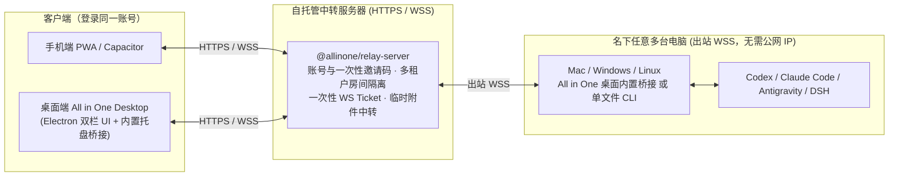

# All in One · 跨设备 AI 编程助手远程总控

<p align="center">
  <strong>中文</strong> · <a href="./README_EN.md">English</a>
</p>

<p align="center">
  <a href="./LICENSE"></a>
  = 22.13" />
  
  <a href="https://github.com/RainbowLion0320/AllinOne/actions/workflows/ci.yml"></a>
</p>

**All in One** 是一套**自托管、零侵入、零额外 Token 消耗**的跨设备 AI 编程助手控台（Electron 桌面端 + 手机 PWA / Capacitor 原生壳 + 自建中转网关 + 本机桥接引擎）。

只需在自己的手机和任意多台电脑上登录同一个账号，即可在手机或另一台电脑上**原位续聊**任意一台绑定电脑里的 **Codex / Claude Code / Antigravity / DeepSeek Harness** 全部本地对话，直接复用本机项目工作区、本地会话数据库与厂商 Prompt Cache。

---

## 核心特性

- **零侵入纯桥接 · 0 额外 Token**：不改写提示词、不注入代理层或额外上下文，直接通过各 AI 工具官方本地协议/CLI 读写原生会话，手机与电脑无缝接力。
- **4 大主流 AI 工具统一原生接入**：

  | 工具 | 接入方式 | 支持能力 | 前置要求 |
  | :--- | :--- | :--- | :--- |
  | **Codex** | 官方 `codex app-server --stdio`（读写分离双进程，每轮自动释放锁） | 全量读写会话、模型与推理强度切换、中断 | 已安装 Codex CLI 或 macOS `ChatGPT.app`（自动发现内置 `codex`） |
  | **Claude Code** | 官方 `claude -p --resume --output-format stream-json` | 全量读写 `~/.claude/projects/` 会话、模型切换、中断 | 已安装并登录 `claude` CLI |
  | **Antigravity** | 官方 `agy acp --app-data-dir antigravity` 热保活会话池 | 与桌面端共享登录态与会话历史、11 组模型与推理档位切换、长任务回调 | 已安装 Antigravity 及官方 [`agy` CLI](#各-ai-工具前置条件) |
  | **DeepSeek Harness** | 原生 Cordis 插件 (`dsh-mobile-hub`) / 本地只读会话读取 | 插件挂载后全量读写与模型切换；独立桥接下自动只读历史 | 已安装 DeepSeek Harness（可选挂载插件开启写权限） |

- **账号 + 一次性邀请码体系 · 多电脑自动互联**：
  - 管理员通过 CLI 或 App 后台按需签发**严格一次性**邀请码（`INV-XXXX-XXXX`），用完即销毁；
  - 同一账号在多台电脑登录后自动注册并在线互联，手机端与桌面端登录后自动发现名下全部在线电脑，一键无缝切换。
- **一步到位桌面端（Electron Desktop App）**：
  - 打包内置 Node 22 运行时、单文件桥接引擎、菜单栏/系统托盘常驻与桌面双栏 UI，目标电脑**无需手动安装 Node.js 或敲命令行**，安装后登录账号即自动上线并可随系统自启。
- **移动端深度体验**：PWA 离线缓存与主屏安装、按项目/时间分组与增量翻页、本机截图安全代理预览与双指缩放、二维码扫码（含相册兜底）。

---

## 系统架构



---

## 仓库结构

```text
AllinOne/
├── packages/
│   ├── shared/          # 统一 RPC / Event 协议与安全工具
│   ├── relay-server/    # 自建中转网关（HTTPS/WSS + 账号/邀请码 + 多租户隔离 + 静态托管）
│   ├── dsh-mobile-hub/  # 本机桥接引擎（4 大 AI 适配器 + 单文件便携 CLI + DSH 插件）
│   ├── mobile-app/      # 响应式前端（React + Tailwind + PWA + Capacitor 壳）
│   └── desktop-app/     # Electron 桌面总控客户端（内置桥接器 + 托盘 + DMG/NSIS 打包）
├── deploy/              # Dockerfile / docker-compose.yml / Caddyfile / nginx.conf
├── scripts/             # 单文件桥接打包器 (build-portable-bridge.mjs) 与冒烟测试 (smoke-test.mjs)
└── .github/workflows/   # CI 自动构建测试 & 桌面端自动打包工作流
```

---

## 快速开始

### 1. 本地开发联调（3 分钟跑通）

> 环境要求：**Node.js >= 22.13.0**

```bash
# 1. 克隆并安装依赖
git clone https://github.com/RainbowLion0320/AllinOne.git
cd AllinOne
npm install

# 2. 打包单文件 PC 桥接器 + 前端静态资源
npm run build

# 3. 生成首个管理员一次性邀请码（用于注册你的第一个账号）
npm run admin -- invite create --count 1 --admin --note "管理员首号"

# 4. 启动中转服务器（默认监听 http://127.0.0.1:8787）
npm run start:relay
```

打开浏览器访问 `http://127.0.0.1:8787`：
1. 切换到「注册」，输入刚才生成的邀请码创建你的管理员账号；
2. 新开终端启动本机桥接（输入同一账号密码即可绑定本机）：
   ```bash
   node packages/mobile-app/public/downloads/allinone-bridge.mjs --server http://127.0.0.1:8787
   ```
3. 或直接运行 Electron 桌面端开发模式（同时包含双栏界面与内置桥接）：
   ```bash
   npm run dev:desktop
   ```

---

### 2. 自托管部署到 Linux 服务器（推荐 Docker + Caddy）

```bash
# 1. 在服务器上克隆仓库
git clone https://github.com/RainbowLion0320/AllinOne.git
cd AllinOne

# 2. 将 deploy/Caddyfile 中的 ai.yourdomain.com 改为你的真实域名（DNS A 记录指向本服务器）

# 3. 创建 deploy/.env（务必使用高强度随机密钥，切勿提交到 Git）
cat > deploy/.env <<'EOF'
CLIENT_ACCESS_TOKEN=请替换为至少16位高强度管理员密钥
BRIDGE_SECRET=请替换为至少16位高强度桥接密钥
JWT_SECRET=请替换为32位以上随机串
PUBLIC_RELAY_URL=https://ai.yourdomain.com
VITE_RELAY_URL=https://ai.yourdomain.com
EOF

# 4. 一键构建并启动（自动构建单文件桥接器、前端 PWA 与 HTTPS 证书）
cd deploy
docker compose --env-file .env up -d --build
```

#### 生成首个管理员邀请码（必做）

首次启动后，通过容器内管理 CLI 生成你的第 1 个管理员一次性邀请码：

```bash
docker exec allinone-relay node packages/relay-server/src/admin-cli.js invite create --count 1 --admin --note "owner"
docker compose restart allinone-relay
```

> 拿到管理员账号并在 App/网页登录后，后续就可以直接在客户端的「邀请码管理」界面一键生成、查看和作废普通用户邀请码，**无需再登服务器或重启服务**。

<details>
<summary>常用管理 CLI 命令</summary>

```bash
# 生成 3 个普通一次性邀请码
npm run admin -- invite create --count 3 --note "给朋友"

# 查看所有邀请码状态
npm run admin -- invite list

# 作废未使用的邀请码
npm run admin -- invite revoke INV-XXXX-XXXX

# 查看已注册账号及绑定电脑数
npm run admin -- users
```

</details>

---

### 3. 连接电脑（3 种方式任选）

#### 方式 A：All in One 桌面客户端（推荐 · 零配置一步到位）

自带内置 Node 运行时与托盘桥接器，支持 macOS (Apple Silicon) 与 Windows (x64) 打包：

```bash
# 将你自建的服务器地址写入仓库根目录 .env.local（已被 .gitignore 忽略）
cat > .env.local <<'EOF'
PUBLIC_RELAY_URL=https://ai.yourdomain.com
VITE_RELAY_URL=https://ai.yourdomain.com
EOF

# macOS 打包 .dmg（输出在 packages/desktop-app/release/）
npm run pack:mac

# Windows 打包 NSIS .exe 安装向导（在 Windows 上运行）
npm run pack:win
```

安装打开并登录你的账号后，桌面端会自动把本机绑定到账号下并在后台常驻托盘；关闭窗口不会断开手机连接。

#### 方式 B：1 行命令行桥接（macOS / Linux / Windows 通用）

适合纯终端或服务器环境（需要本机已装 Node.js v18+，推荐 v22+）：

- **macOS / Linux**：
  ```bash
  curl -fsSL https://ai.yourdomain.com/setup.sh | bash
  ```
- **Windows (PowerShell)**：
  ```powershell
  irm https://ai.yourdomain.com/setup.ps1 | iex
  ```

#### 方式 C：挂载为 DeepSeek Harness Desktop 插件（开启 DSH 全量写权限）

1. 复制 `packages/dsh-mobile-hub/cordis.patch.example.yml` 为 `packages/dsh-mobile-hub/cordis.patch.yml`（已被 `.gitignore` 忽略），填入自建中转 `relayUrl` 与环境变量/密钥路径。
2. 在 `~/.dsh/profiles/desktop/package.json` 的 `dependencies` 中链接 `dsh-mobile-hub` 并加入 `dsh.profile.bundles`，重启 DeepSeek Harness 即可。

---

### 4. 各 AI 工具前置条件

All in One 本身不内置大模型或 API Key，而是直接驱动你电脑上已登录的本地工具：

- **Codex**：已安装 `codex` CLI 或 macOS `/Applications/ChatGPT.app`（桥接器会自动探测 PATH、ChatGPT.app 内置二进制与运行中进程）。
- **Claude Code**：已安装并完成登录的 `claude` CLI。
- **Antigravity**：macOS 的 `Antigravity.app` 不内置命令行工具，如需在远程读写会话与切换模型，请额外安装官方 `agy` CLI：
  - macOS / Linux：`curl -fsSL https://antigravity.google/cli/install.sh | bash`
  - Windows (PowerShell)：`irm https://antigravity.google/cli/install.ps1 | iex`
- **DeepSeek Harness**：独立桥接自动支持历史会话只读；如需远程续聊请通过方式 C 挂载插件。

---

### 5. 手机端安装

- **PWA（推荐，iOS / Android 通用）**：用手机浏览器打开 `https://ai.yourdomain.com` →「添加到主屏幕」。
- **Capacitor 原生壳（可选）**：修改 `packages/mobile-app/capacitor.config.json` 中的 `server.url` 为你的 HTTPS 域名后执行：
  ```bash
  cd packages/mobile-app
  npm run build
  npx cap sync android   # 或 ios
  npx cap open android
  ```
  > 如需在纯内网 HTTP 调试 Android 壳，可在本地临时把 `cleartext` 设为 `true`，生产环境强烈建议保持 HTTPS 且 `cleartext: false`。

---

## 安全模型与免责声明

在部署或使用前，请务必阅读完整的 [SECURITY.md](./SECURITY.md)：

1. **必须自托管 + HTTPS/WSS**：本系统使用 HTTPS/WSS 保障传输加密，中转服务器需要路由消息和转发临时附件（非零知识端到端加密），**切勿将本机桥接连接到陌生人部署的第三方中转服务**。
2. **默认高权限自动执行**：为了在手机端远程流畅完成编程任务，桥接器默认启用了自动审批/编辑模式（例如 Antigravity 的 `--dangerously-skip-permissions`、DSH 的 `danger-full-access`、Claude 的 `acceptEdits`）。你可以在配置文件或适配器选项中手动收紧权限，详情见 [SECURITY.md](./SECURITY.md)。
3. **独立开源免责声明**：本项目为社区独立开源工具，与 DeepSeek、OpenAI、Anthropic、Google 无任何官方隶属、授权或合作关系；所有第三方品牌名称与图标均归各自权利人所有。

---

## 端到端冒烟测试

```bash
npm run test:smoke
```

测试覆盖：生产默认弱密钥拒启、一次性邀请码核销与作废、账号登录与多电脑自动发现、WS Ticket 防重放、Origin 校验、SSRF 拦截、限流保护、4 大应用模型拉取与会话读写隔离。

## 参与贡献 & 开源协议

- 欢迎提 Issue 或 PR，详情请参阅 [CONTRIBUTING.md](./CONTRIBUTING.md)。
- 本项目基于 [MIT License](./LICENSE) 开源。
