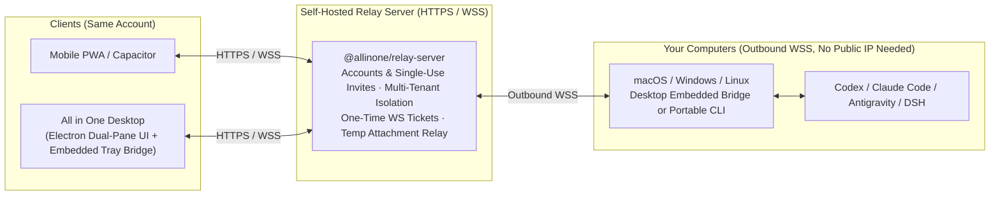

# All in One · Cross-Device AI Coding Agent Control Center

<p align="center">
  <a href="./README.md">中文</a> · <strong>English</strong>
</p>

<p align="center">
  <a href="./LICENSE"></a>
  = 22.13" />
  
  <a href="https://github.com/RainbowLion0320/AllinOne/actions/workflows/ci.yml"></a>
</p>

**All in One** is a **self-hosted, zero-invasion, zero-extra-token** remote control suite (Electron Desktop App + Mobile PWA / Capacitor shell + Self-hosted Relay Server + Local PC Bridge) for managing local AI coding agents across all of your devices.

Sign in with the same account on your phone and any number of computers to **resume native local sessions in-place** across **Codex, Claude Code, Antigravity, and DeepSeek Harness**, reusing your machine's local workspace, native session stores, and vendor prompt caches.

---

## Key Features

- **Zero-Invasion Native Bridge (0 Extra Tokens)**: No wrapper prompts or proxy context injection — communicates directly through each agent's official local protocol/CLI so desktop and mobile sessions stay natively synced.
- **4 Major Coding Agents Unified**:

  | Agent | Native Integration | Capabilities | Prerequisites |
  | :--- | :--- | :--- | :--- |
  | **Codex** | Official `codex app-server --stdio` (read/write split, auto-releases write lock per turn) | Full R/W sessions, model & reasoning effort switching, interrupt | `codex` CLI or macOS `ChatGPT.app` (auto-discovers bundled `codex`) |
  | **Claude Code** | Official `claude -p --resume --output-format stream-json` | Full R/W `~/.claude/projects/` sessions, model switching, interrupt | Authenticated `claude` CLI |
  | **Antigravity** | Official `agy acp --app-data-dir antigravity` warm session pool | Shares desktop auth/history, full model family & reasoning switching, background task updates | Antigravity + official [`agy` CLI](#agent-prerequisites) |
  | **DeepSeek Harness** | Native Cordis plugin (`dsh-mobile-hub`) / standalone read-only reader | Full R/W when mounted as DSH plugin; read-only history in standalone bridge | DeepSeek Harness (optional plugin mount for writes) |

- **Account + Single-Use Invite Codes & Auto Multi-PC Discovery**:
  - Admins issue strictly single-use invite codes (`INV-XXXX-XXXX`) via CLI or in-app UI;
  - Every PC signed into your account registers its own isolated room/credentials and appears automatically on your phone and desktop apps.
- **All-in-One Electron Desktop Client**:
  - Bundles Node 22, the portable PC bridge, system tray / menu bar residency, and a dual-pane UI into a single `.dmg` / `.exe` installer — no manual Node.js setup or terminal commands required on target machines.
- **Mobile-First Experience**: Installable PWA, project/time grouping, incremental history paging + IndexedDB cache, secure local screenshot preview with pinch-zoom, and built-in QR scanner.

---

## Architecture



---

## Monorepo Layout

```text
AllinOne/
├── packages/
│   ├── shared/          # Shared RPC / Event protocol and path/ID guards
│   ├── relay-server/    # Self-hosted HTTPS/WSS gateway, account/invite store & static host
│   ├── dsh-mobile-hub/  # Local multi-agent bridge, portable single-file CLI & DSH plugin
│   ├── mobile-app/      # Responsive React + Tailwind + PWA + Capacitor UI
│   └── desktop-app/     # Electron desktop app (embedded bridge, tray, macOS/Windows packaging)
├── deploy/              # Dockerfile, docker-compose.yml, Caddyfile, nginx.conf
├── scripts/             # Portable bridge bundler & end-to-end smoke test suite
└── .github/workflows/   # CI build/test & desktop installer release workflows
```

---

## Quick Start

### 1. Local Development (3 Minutes)

> Requirement: **Node.js >= 22.13.0**

```bash
# 1. Clone and install dependencies
git clone https://github.com/RainbowLion0320/AllinOne.git
cd AllinOne
npm install

# 2. Build the portable PC bridge + web frontend
npm run build

# 3. Generate your first single-use admin invite code
npm run admin -- invite create --count 1 --admin --note "owner"

# 4. Start the relay server (default: http://127.0.0.1:8787)
npm run start:relay
```

Open `http://127.0.0.1:8787`, register your admin account using the invite code, then either:
- Launch the Electron desktop app (UI + embedded bridge): `npm run dev:desktop`, or
- Run the portable bridge CLI: `node packages/mobile-app/public/downloads/allinone-bridge.mjs --server http://127.0.0.1:8787`

---

### 2. Self-Host on Linux (Recommended: Docker + Caddy)

```bash
git clone https://github.com/RainbowLion0320/AllinOne.git
cd AllinOne

# 1. Replace `ai.yourdomain.com` in deploy/Caddyfile with your real domain

# 2. Create deploy/.env with strong random secrets (never commit to Git)
cat > deploy/.env <<'EOF'
CLIENT_ACCESS_TOKEN=replace-with-strong-admin-token
BRIDGE_SECRET=replace-with-strong-bridge-secret
JWT_SECRET=replace-with-32-plus-char-random-secret
PUBLIC_RELAY_URL=https://ai.yourdomain.com
VITE_RELAY_URL=https://ai.yourdomain.com
EOF

# 3. Build and start (automatically bundles the portable bridge, PWA, and HTTPS certs)
cd deploy
docker compose --env-file .env up -d --build

# 4. Bootstrap your first single-use admin invite code
docker exec allinone-relay node packages/relay-server/src/admin-cli.js invite create --count 1 --admin --note "owner"
docker compose restart allinone-relay
```

After registering your admin account, you can generate and revoke additional invite codes directly inside the app UI without touching the server or restarting.

---

### 3. Connect Your Computers

#### Option A: All in One Desktop App (Recommended)

Configure your server URL in `.env.local` (gitignored), then build a self-contained installer:

```bash
cat > .env.local <<'EOF'
PUBLIC_RELAY_URL=https://ai.yourdomain.com
VITE_RELAY_URL=https://ai.yourdomain.com
EOF

npm run pack:mac   # macOS arm64 .dmg -> packages/desktop-app/release/
npm run pack:win   # Windows x64 NSIS .exe (run on Windows)
```

#### Option B: 1-Line Portable CLI Bridge

- **macOS / Linux**: `curl -fsSL https://ai.yourdomain.com/setup.sh | bash`
- **Windows (PowerShell)**: `irm https://ai.yourdomain.com/setup.ps1 | iex`

---

### Agent Prerequisites (Automatic Half-Installed Completion)

All in One connects directly to the AI coding agents already on your computer. On startup, the bridge automatically inspects your local setup: **if it detects a half-installed tool (for example, `Antigravity.app` is installed without the `agy` CLI, or `~/.claude/projects` / `~/.codex/sessions` exists without the CLI binary), it silently runs the official installer in the background and hot-refreshes readiness automatically** — while never installing tools you don't use. Set `ALLINONE_NO_AUTOFIX=1` to disable automatic background CLI completion.

- **Codex**: `codex` CLI on `PATH`, or macOS `/Applications/ChatGPT.app` (bundled CLI auto-discovered; half-installed state auto-completed).
- **Claude Code**: Authenticated `claude` CLI (auto-completed if local sessions/config exist without the binary).
- **Antigravity**: Automatically installs official `agy` CLI when Antigravity Desktop/data is detected and reuses Desktop auth seamlessly (manual install: `curl -fsSL https://antigravity.google/cli/install.sh | bash` / Windows `irm https://antigravity.google/cli/install.ps1 | iex`).
- **DeepSeek Harness**: Standalone bridge provides read-only history; mount `packages/dsh-mobile-hub` as a DSH Cordis plugin (see `cordis.patch.example.yml`) for full read/write.

---

## Security & Disclaimer

Please review [SECURITY.md](./SECURITY.md) before deploying:

1. **Self-Host Over HTTPS/WSS Only**: Traffic is encrypted in transit with TLS (HTTPS/WSS), while the relay routes messages and temporary uploads (not zero-knowledge E2EE). Only connect your PC bridge to a relay server you control.
2. **Autonomous Execution Defaults**: For smooth remote coding, adapters default to autonomous/auto-approve modes (`--dangerously-skip-permissions` for Antigravity, `danger-full-access` for DSH, `acceptEdits` for Claude). See [SECURITY.md](./SECURITY.md) for how to restrict these permissions.
3. **Affiliation Notice**: All in One is an independent open-source project and is not affiliated with, endorsed by, or sponsored by DeepSeek, OpenAI, Anthropic, or Google.

---

## Testing, Contributing & License

- End-to-end smoke suite: `npm run test:smoke`
- Contribution guide: [CONTRIBUTING.md](./CONTRIBUTING.md)
- License: [MIT](./LICENSE)
