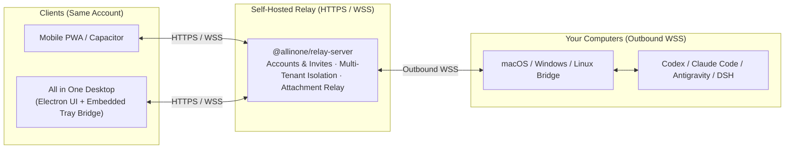

# All in One

<p align="center">
  <a href="./README.md">中文</a> · <strong>English</strong>
</p>

<p align="center">
  <a href="https://github.com/RainbowLion0320/AllinOne/releases/latest"></a>
  <a href="./LICENSE"></a>
  
  <a href="https://github.com/RainbowLion0320/AllinOne/actions/workflows/ci.yml"></a>
</p>

Continue your local **Codex, Claude Code, Antigravity, and DeepSeek Harness** conversations from your phone or any other computer.

All in One runs a lightweight relay on your own server and connects directly to each agent's official local interface, reusing your local workspaces, session history, and vendor prompt caches. Sign in with the same account across devices to discover and switch between all of your online computers automatically.

---

## Quick Start

### 1. Install the Client (You Have a Server URL & Invite Code)

#### Desktop

1. Download and install from [**GitHub Releases**](https://github.com/RainbowLion0320/AllinOne/releases/latest):
   - **macOS (Apple Silicon)**: `All in One-*-arm64.dmg`
   - **Windows (x64)**: `All in One Setup *.exe`
2. Open **All in One**, enter your server URL, and register with your invite code or sign in.
3. Once signed in, the app binds this computer to your account, stays connected in the system tray, and detects your installed AI coding tools (automatically installing missing official CLI companions when a desktop app or session store is already present).

> On macOS, if Gatekeeper blocks the first launch of this un-notarized build, allow it under **System Settings → Privacy & Security → Open Anyway**, or run `xattr -cr "/Applications/All in One.app"` once in Terminal.
>
> On Linux or headless machines, connect with a single command:
> - macOS / Linux: `curl -fsSL https://your-server/setup.sh | bash`
> - Windows (PowerShell): `irm https://your-server/setup.ps1 | iex`

#### Mobile

Open your server URL in your mobile browser and tap **Add to Home Screen** to install as a PWA. Sign in with the same account to access all of your online computers.

---

### 2. Self-Host the Relay Server (Docker)

Deploy the relay on your own Linux server:

```bash
# 1. Clone the repository
git clone https://github.com/RainbowLion0320/AllinOne.git
cd AllinOne

# 2. Replace ai.yourdomain.com in deploy/Caddyfile with your domain (DNS pointed to this server)

# 3. Create deploy/.env with strong random secrets
cat > deploy/.env <<'EOF'
CLIENT_ACCESS_TOKEN=replace-with-strong-admin-token
BRIDGE_SECRET=replace-with-strong-bridge-secret
JWT_SECRET=replace-with-32-plus-char-random-secret
PUBLIC_RELAY_URL=https://ai.yourdomain.com
VITE_RELAY_URL=https://ai.yourdomain.com
EOF

# 4. Build and start (includes Caddy for automatic HTTPS)
cd deploy
docker compose --env-file .env up -d --build

# 5. Create your first admin invite code
docker exec allinone-relay node packages/relay-server/src/admin-cli.js invite create --count 1 --admin --note "owner"
docker compose restart allinone-relay
```

Then follow **1. Install the Client** above to register your admin account. Additional single-use invite codes can be created and revoked directly inside the app UI.

---

## Supported Agents

| Agent | Integration | Capabilities | Notes |
| :--- | :--- | :--- | :--- |
| **Codex** | `codex app-server --stdio` | Read/write sessions, model & reasoning switching, interrupt | Auto-discovers PATH & macOS `ChatGPT.app` bundled CLI |
| **Claude Code** | `claude -p --resume --output-format stream-json` | Read/write `~/.claude/projects/` sessions, model switching, interrupt | Reuses local login |
| **Antigravity** | `agy acp --app-data-dir antigravity` | Shared desktop history & auth, model & effort switching, background tasks | Syncs Desktop updates live to All in One; after sending turns remotely to an already-open Desktop thread, restart `Antigravity.app` before resuming that thread natively |
| **DeepSeek Harness** | Native Cordis plugin (`dsh-mobile-hub`) | Read/write & model switching as plugin; read-only history standalone | Plugin setup in Developer Guide below |

- **Multi-Device Control**: Sign in with the same account on phones and desktops to operate any of your online computers.
- **Single-Use Invites**: Issue `INV-XXXX-XXXX` codes on demand with strict per-account isolation.
- **Native Sessions**: Uses each agent's local storage and official protocol directly so context and prompt caches carry over seamlessly.

---

## Architecture



---

## Developer Guide

> Building from source requires **Node.js >= 22.13.0**.

<details>
<summary>1. Local development</summary>

```bash
git clone https://github.com/RainbowLion0320/AllinOne.git
cd AllinOne
npm install
npm run build
npm run admin -- invite create --count 1 --admin --note "dev"
npm run start:relay
# In a second terminal:
npm run dev:desktop
```

</details>

<details>
<summary>2. Build custom installers with your server URL pre-filled</summary>

```bash
cat > .env.local <<'EOF'
PUBLIC_RELAY_URL=https://ai.yourdomain.com
VITE_RELAY_URL=https://ai.yourdomain.com
EOF

npm run pack:mac   # packages/desktop-app/release/*.dmg
npm run pack:win   # packages/desktop-app/release/*.exe (run on Windows)
```

You can also run **Actions → Build Desktop Installers → Run workflow** on your fork with a custom `relay_url`.

</details>

<details>
<summary>3. Capacitor mobile shell, DSH plugin & smoke tests</summary>

- **Capacitor**: Update `server.url` in `packages/mobile-app/capacitor.config.json`, then run `npm run build && npx cap sync android`.
- **DeepSeek Harness plugin**: Copy `packages/dsh-mobile-hub/cordis.patch.example.yml` to `cordis.patch.yml`, link `dsh-mobile-hub` in `~/.dsh/profiles/desktop/package.json`, and restart DSH.
- **Disable background CLI completion**: Set `ALLINONE_NO_AUTOFIX=1`.
- **Run smoke & security tests**: `npm run test:smoke`.

</details>

---

## Security, Contributing & License

Please review [SECURITY.md](./SECURITY.md) before deploying:

- **Self-Host Over HTTPS/WSS**: Traffic uses TLS and the relay routes messages and temporary attachments, so connect only to a server you control.
- **Permissions**: Adapters default to autonomous approval/edit presets for remote usability; see [SECURITY.md](./SECURITY.md) to tighten them.
- **Notice**: Independent open-source project; affiliated with none of DeepSeek, OpenAI, Anthropic, or Google.
- **Contributing & License**: See [CONTRIBUTING.md](./CONTRIBUTING.md) · Licensed under [MIT](./LICENSE).
