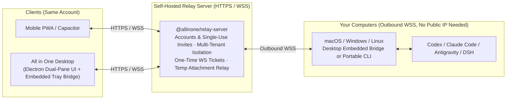

# All in One · Cross-Device AI Coding Agent Control Center

<p align="center">
  <a href="./README.md">中文</a> · <strong>English</strong>
</p>

<p align="center">
  <a href="https://github.com/RainbowLion0320/AllinOne/releases/latest"></a>
  <a href="./LICENSE"></a>
  
  <a href="https://github.com/RainbowLion0320/AllinOne/actions/workflows/ci.yml"></a>
</p>

**All in One** is a **1-click install, self-hosted, zero-invasion, zero-extra-token** control center for operating local AI coding agents across all of your computers and phones.

Sign in with the same account on your phone and any number of computers to **resume native local sessions in-place** across **Codex, Claude Code, Antigravity, and DeepSeek Harness**, reusing your machine's local workspaces and vendor prompt caches.

---

## 1. Quick Install (Zero-Config Setup)

### For Users (You Already Have a Server URL & Invite Code)

**No Node.js, no Git, and no terminal setup required:**

1. **Install the Desktop App (All-in-One Installer, Recommended)**
   - Download the installer from [**GitHub Releases**](https://github.com/RainbowLion0320/AllinOne/releases/latest):
     - **macOS (Apple Silicon)**: `All in One-*-arm64.dmg` (drag to Applications)
     - **Windows (x64)**: `All in One Setup *.exe` (standard installer wizard)
   - Launch **All in One**, enter your Relay Server URL, and sign in (or register with a single-use invite code).
   - Once signed in, the app automatically:
     - Binds this computer to your account and runs the embedded PC bridge in the menu bar / system tray (stays reachable even when the window is closed);
     - Auto-discovers locally installed **Codex, Claude Code, Antigravity, and DeepSeek Harness**;
     - **Auto-completes half-installed CLI tools in the background**: if an AI desktop app or local session history exists without its CLI binary (e.g., `Antigravity.app` installed without `agy`), the bridge silently installs the official CLI and hot-refreshes readiness — while never touching tools you don't use.
   - *Headless / Linux alternative (1-line command)*:
     - macOS / Linux: `curl -fsSL https://your-server/setup.sh | bash`
     - Windows (PowerShell): `irm https://your-server/setup.ps1 | iex`

2. **Use on Mobile (No App Store Needed — iOS & Android)**
   - Open your server URL (or invite link) in your mobile browser → **Add to Home Screen** (PWA).
   - Sign in with the same account and all of your online computers appear automatically.

---

### For Server Owners (3-Minute Self-Hosted Docker Deploy)

All in One is **100% self-hosted**. Deploy the relay gateway on your own Linux server with automatic HTTPS via Caddy:

```bash
# 1. Clone the repository
git clone https://github.com/RainbowLion0320/AllinOne.git
cd AllinOne

# 2. Replace `ai.yourdomain.com` in deploy/Caddyfile with your real domain

# 3. Create deploy/.env with strong random secrets (never commit to Git)
cat > deploy/.env <<'EOF'
CLIENT_ACCESS_TOKEN=replace-with-strong-admin-token
BRIDGE_SECRET=replace-with-strong-bridge-secret
JWT_SECRET=replace-with-32-plus-char-random-secret
PUBLIC_RELAY_URL=https://ai.yourdomain.com
VITE_RELAY_URL=https://ai.yourdomain.com
EOF

# 4. Build & launch (bundles PWA, portable bridge, and auto-HTTPS)
cd deploy
docker compose --env-file .env up -d --build

# 5. Bootstrap your first single-use admin invite code (one-time)
docker exec allinone-relay node packages/relay-server/src/admin-cli.js invite create --count 1 --admin --note "owner"
docker compose restart allinone-relay
```

Then return to **[For Users](#for-users-you-already-have-a-server-url--invite-code)** to install the Desktop App or open `https://ai.yourdomain.com` and register your admin account. After that, you can create and revoke single-use invite codes directly inside the app UI without SSHing into the server.

---

## 2. Key Features & Supported Agents

- **Zero-Invasion Native Bridge (0 Extra Tokens)**: Talks directly to each agent's official local protocol/CLI without wrapper prompts or proxy context overhead.
- **Any-Device to Any-PC Control**: Operate any of your computers from your phone OR from another Mac/Windows desktop running All in One.
- **Single-Use Invite Codes & Isolated Multi-Tenancy**: Salted `scrypt` password hashes, hashed per-PC credentials, and isolated rooms per account.
- **4 Unified AI Coding Agents**:

  | Agent | Native Protocol | Capabilities | Cross-Client Sync Notes |
  | :--- | :--- | :--- | :--- |
  | **Codex** | `codex app-server --stdio` (read/write split, auto-releases lock) | Full R/W, model & effort switching, interrupt | Auto-discovers PATH & macOS `ChatGPT.app` bundled CLI |
  | **Claude Code** | `claude -p --resume --output-format stream-json` | Full R/W `~/.claude/projects/`, model switch, interrupt | Seamless switching; auto-completes half-installed CLI |
  | **Antigravity** | `agy acp --app-data-dir antigravity` warm pool + live disk watcher | Shared auth/history, 11 model families + effort tiers, background tasks | Real-time Desktop → All in One sync; if you send turns via All in One to an already-open Desktop thread, restart `Antigravity.app` before resuming that thread in the native app |
  | **DeepSeek Harness** | Native Cordis plugin (`dsh-mobile-hub`) / standalone read-only | Full R/W when mounted as DSH plugin; read-only history standalone | Shared in-process state when mounted as plugin |

---

## 3. Architecture



---

## 4. Developer & Custom Build Guide

> Requires **Node.js >= 22.13.0** for building from source.

<details>
<summary>Local development (3 minutes)</summary>

```bash
git clone https://github.com/RainbowLion0320/AllinOne.git
cd AllinOne
npm install
npm run build
npm run admin -- invite create --count 1 --admin --note "dev"
npm run start:relay
# In a second terminal:
npm run dev:desktop
```

</details>

<details>
<summary>Build custom desktop installers with your server URL pre-filled</summary>

```bash
cat > .env.local <<'EOF'
PUBLIC_RELAY_URL=https://ai.yourdomain.com
VITE_RELAY_URL=https://ai.yourdomain.com
EOF

npm run pack:mac   # macOS arm64 .dmg -> packages/desktop-app/release/
npm run pack:win   # Windows x64 .exe (run on Windows)
```

You can also trigger **Actions → Build Desktop Installers → Run workflow** on your fork with an optional `relay_url` input to build both macOS and Windows installers in CI.

</details>

<details>
<summary>Monorepo layout, Capacitor builds, DSH plugin & smoke tests</summary>

- `packages/shared` — Shared RPC / Event protocol and path/ID guards
- `packages/relay-server` — Self-hosted HTTPS/WSS gateway, accounts, invites & static host
- `packages/dsh-mobile-hub` — Local bridge orchestrator, 4 agent adapters, CLI auto-completion & portable CLI
- `packages/mobile-app` — Responsive React + Tailwind + PWA + Capacitor UI (`npx cap sync android`)
- `packages/desktop-app` — Electron desktop app with embedded bridge & tray
- Opt out of background CLI auto-completion with `ALLINONE_NO_AUTOFIX=1`
- Run all 11 end-to-end & security smoke tests: `npm run test:smoke`

</details>

---

## 5. Security, Contributing & License

Please review [SECURITY.md](./SECURITY.md) before deploying:

1. **Self-Host Over HTTPS/WSS Only**: Traffic uses TLS (not zero-knowledge E2EE). Never connect your PC bridge to an untrusted third-party relay.
2. **Autonomous Execution Defaults**: Adapters default to autonomous approval/edit presets for smooth remote coding; see [SECURITY.md](./SECURITY.md) for how to tighten them.
3. **Affiliation Notice**: Independent open-source project; not affiliated with DeepSeek, OpenAI, Anthropic, or Google.
4. **Contributing & License**: See [CONTRIBUTING.md](./CONTRIBUTING.md) · Licensed under [MIT](./LICENSE).
