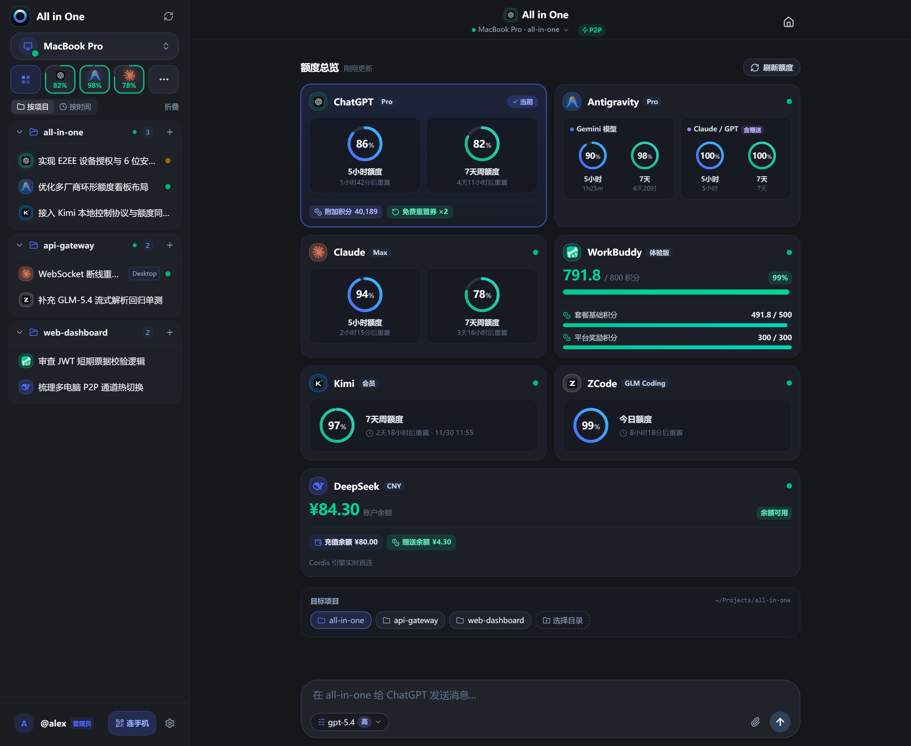
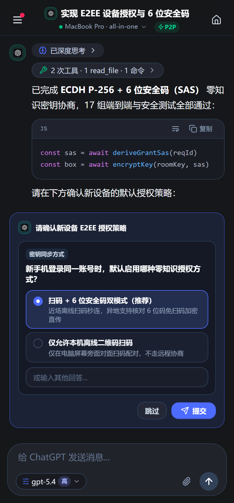
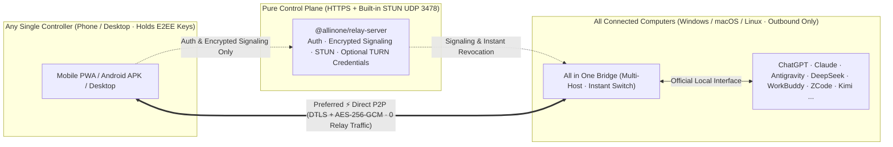

<div align="center">


<h1>All in One</h1>

<p>
  <strong>Not an Agent. Not a Harness. Just a Tool.</strong><br/>
  <sub>Control every connected computer from any single device — zero prompt injection, zero extra tokens, end-to-end encrypted</sub>
</p>

<p>
   <strong>ChatGPT</strong> &nbsp;·&nbsp;
   <strong>Claude</strong> &nbsp;·&nbsp;
   <strong>Antigravity</strong> &nbsp;·&nbsp;
   <strong>DeepSeek</strong> &nbsp;·&nbsp;
   <strong>WorkBuddy</strong> &nbsp;·&nbsp;
   <strong>ZCode</strong> &nbsp;·&nbsp;
   <strong>Kimi</strong> &nbsp;·&nbsp; <em>and more</em>
  <br/>
  <sub>Currently integrated — continuously expanding to more AI tools</sub>
</p>

<p>
  <a href="./README.md">中文</a> · <strong>English</strong>
</p>

<p>
  <a href="https://github.com/RainbowLion0320/AllinOne/releases/latest"></a>
  
  
  <a href="https://github.com/RainbowLion0320/AllinOne/actions/workflows/ci.yml"></a>
  <a href="./LICENSE"></a>
</p>

<p>
  <a href="#-supported-ai-tools">Supported Tools</a> ·
  <a href="#-quick-start">Quick Start</a> ·
  <a href="#-security--architecture">Security</a> ·
  <a href="#-one-click-self-hosting-docker">Self-Hosting</a> ·
  <a href="#-developer-guide">Developers</a>
</p>

</div>

---

## Preview

<table>
  <tr>
    <td width="72%" align="center" valign="bottom">
      
      <br/>
      <sub><strong>Desktop / Web</strong> — Multi-host switcher, smart vendor sidebar &amp; live home quota/balance dashboard</sub>
    </td>
    <td width="28%" align="center" valign="bottom">
      
      <br/>
      <sub><strong>Mobile PWA / Android</strong> — Continue chats, inspect code &amp; approve prompts anywhere</sub>
    </td>
  </tr>
</table>

- **One Device, Every Connected Computer**: Use a single phone or any computer to switch between and orchestrate all your linked Windows / macOS / Linux machines — reusing each machine's existing threads, workspaces, and vendor prompt caches, with a live home dashboard for 5h/weekly limits, credits, and balances.
- **Direct P2P First, Zero Relay Traffic**: Connects directly over encrypted WebRTC DataChannels by default (**0 bytes through your server**); automatically falls back to encrypted TURN on double-symmetric NATs.
- **Mandatory Zero-Knowledge E2EE**: All messages, code, and files are encrypted end-to-end with 256-bit `AES-256-GCM` keys — your server handles only auth and signaling.
- **Cross-Platform Control & 1-Minute Self-Hosting**: Control from macOS / Windows desktop, Android APK (with signed in-app OTA hot updates), or iOS PWA; link headless Linux hosts with one command, and self-host on any 1-vCPU VPS via Docker.

---

## 🤖 Supported AI Tools

| Tool | Support |
| :--- | :--- |
|  **OpenAI ChatGPT** | Remote Chat · Quota Tracking |
|  **Claude Code / Desktop** | Remote Chat · Quota Tracking |
|  **Google Antigravity** | Remote Chat · Quota Tracking |
|  **DeepSeek Harness** | Remote Chat · Balance Tracking |
|  **Tencent WorkBuddy** | Remote Chat · Credits Tracking |
|  **Zhipu ZCode** | Remote Chat · Quota Tracking |
|  **Moonshot Kimi** | Remote Chat · Quota Tracking |

> Automatically reuses your local sign-in out of the box. More AI tools are continuously being added — request yours in [Issues](https://github.com/RainbowLion0320/AllinOne/issues).

---

## 🚀 Quick Start

> [!TIP]
> **Public Trial Node (Open Self-Registration)**
>
> Set the server URL to **`https://123.206.218.214/dsh/`** to register and try right away (trusted HTTPS + mandatory `AES-256-GCM` E2EE — the server never sees plaintext). Protected by a default 20 sign-ups/day cap, or deploy your own private relay in one minute below.

### Connect in 3 Steps

1. **Install on Your Computer**: Download from [**GitHub Releases**](https://github.com/RainbowLion0320/AllinOne/releases/latest) (macOS `arm64.dmg` / Windows `Setup.exe`), enter your server URL, and sign up / sign in — installed AI tools are detected automatically.
2. **Open on Your Phone**: Scan below to open Mobile Web (iOS: **Add to Home Screen**) or install the Android APK, then sign in with the **same account**.
3. **Sync Your E2EE Key**: Scan your computer's offline QR code or confirm the **6-digit security code (SAS)** to unlock encrypted remote control.

| Mobile Web (iOS / Android) | Android APK (Always Latest) |
| :---: | :---: |
| <a href="https://123.206.218.214/dsh/"></a> | <a href="https://github.com/RainbowLion0320/AllinOne/releases/latest/download/All-in-One-Android.apk"></a> |
| [Open Web App](https://123.206.218.214/dsh/) · Installable PWA | [Download Latest APK](https://github.com/RainbowLion0320/AllinOne/releases/latest/download/All-in-One-Android.apk) · In-app OTA hot updates |

<details>
<summary>Linux one-line bridge &amp; first-launch macOS/Windows prompts</summary>

- **Linux / Headless machine**:
  ```bash
  # macOS / Linux
  curl -fsSL https://your-server/setup.sh | bash

  # Windows (PowerShell)
  irm https://your-server/setup.ps1 | iex
  ```
- **macOS Gatekeeper warning**: Allow in **System Settings → Privacy & Security → Open Anyway**, or run once:
  ```bash
  xattr -cr "/Applications/All in One.app"
  ```
- **Windows SmartScreen**: Click **More info → Run anyway**.
- Set `ALLINONE_NO_AUTOFIX=1` to disable automatic background CLI companion completion.

</details>

---

## 🛡️ Security & Architecture

- **Mandatory Zero-Knowledge E2EE**: All chats, code, images, and files are encrypted client-side (`AES-256-GCM` with 256-bit room keys stored in macOS Keychain / Windows DPAPI).
- **Pure Control Plane, Zero Open Ports**: Computers connect outbound only — direct WebRTC P2P by default (0 relay traffic), with optional encrypted TURN fallback and Relay Data-Saver mode.
- **Zero-Knowledge Device Grant & Instant Revocation**: Sync keys via offline QR or `ECDH P-256 + 6-digit SAS`; revoking a device tears down its P2P DataChannels in milliseconds.
- **Sign-Up Protection**: Built-in daily registration cap (`20/day` default), optional first-admin bootstrap token, and optional free Email 2FA.



---

## 🐳 One-Click Self-Hosting (Docker)

Run one command on any Linux VPS (`amd64` / `arm64`) to deploy in under a minute:

```bash
curl -fsSL https://raw.githubusercontent.com/RainbowLion0320/AllinOne/main/deploy/install.sh | bash
```

- **Automatic HTTPS**: Supports custom domain auto-HTTPS, **bare public IP Let's Encrypt HTTPS**, or container-only mode behind your existing Nginx / Caddy / Cloudflare Tunnel.
- **Built-in STUN (`UDP 3478`)**: Open `UDP 3478` in your cloud firewall for direct P2P; pass `--upgrade` anytime for zero-downtime updates.
- **Instant Admin & Open Sign-Up**: The first account registered on a new server becomes Admin (`https://your-server/admin` for live monitoring & user tiers); open registration defaults to 20 users/day.

<details>
<summary>Advanced: Manual Docker Compose / GitHub OAuth / Email 2FA / Encrypted TURN / Admin CLI</summary>

#### 1. Manual Docker Compose

```bash
git clone https://github.com/RainbowLion0320/AllinOne.git && cd AllinOne
# Update domain in deploy/Caddyfile, then create deploy/.env:
cat > deploy/.env <<'EOF'
JWT_SECRET=replace-with-32-plus-char-random-secret
PUBLIC_RELAY_URL=https://ai.yourdomain.com
VITE_RELAY_URL=https://ai.yourdomain.com
MAX_DAILY_REGISTRATIONS=20
# ADMIN_BOOTSTRAP_TOKEN=optional-secret-to-guard-first-admin-signup
EOF
cd deploy && docker compose --env-file .env pull && docker compose --env-file .env up -d
```

#### 2. Optional Free Email 2FA & Password Reset (SMTP or Resend)

Add to `.env` and restart (`RESEND_API_KEY` + `RESEND_FROM` also supported):

```env
SMTP_HOST=smtp.gmail.com
SMTP_PORT=465
SMTP_SECURE=true
SMTP_USER=your-email@gmail.com
SMTP_PASS=your-app-password
SMTP_FROM=All in One <your-email@gmail.com>
```

#### 3. Optional Encrypted TURN Fallback (Double-Symmetric NAT)

```env
# Self-hosted coturn (set STUN_PORT=off if sharing UDP 3478 on the same host)
STUN_PORT=off
TURN_HOST=ai.yourdomain.com
TURN_PORT=3478
TURN_SECRET=strong-random-secret-matching-coturn
TURN_LOG_FILE=/var/log/coturn/turn.log   # Optional: 4-tier monthly quota metering
TURN_QUOTA_FREE_MB=1024
TURN_QUOTA_PRO_MB=10240
TURN_QUOTA_ULTRA_MB=51200

# Or tiered Cloudflare Realtime TURN (free 1 TB/mo pool)
CF_TURN_TOKEN_ID=your-cf-turn-token-id
CF_TURN_API_TOKEN=your-cf-turn-api-token
CF_TURN_TIERS=free
```

#### 4. Optional GitHub One-Click Sign-In & Account Linking

Create an OAuth App in [GitHub Developer Settings → OAuth Apps](https://github.com/settings/developers) with callback URL `https://your-server/api/auth/github/callback`, then add to `.env` and restart (hidden automatically when unset):

```env
GITHUB_CLIENT_ID=your-github-client-id
GITHUB_CLIENT_SECRET=your-github-client-secret
# GITHUB_REDIRECT_URI=optional (defaults to PUBLIC_RELAY_URL + /api/auth/github/callback)
```

#### 5. Admin CLI

```bash
npm run admin -- users
npm run admin -- user tier <username-or-id> <free|pro|ultra|admin>
```

</details>

---

## 🛠️ Developer Guide

Requires **Node.js >= 22.13.0**:

```bash
git clone https://github.com/RainbowLion0320/AllinOne.git && cd AllinOne
npm install && npm run build
npm run start:relay   # Start local control plane (http://127.0.0.1:8787)
npm run dev:desktop   # Launch Electron desktop app in a second terminal
npm run test:smoke    # Run all 17 E2E & security smoke test suites
```

<details>
<summary>Repository Layout &amp; Custom Packaging (Desktop / Android APK)</summary>

```text
packages/
├── shared/          # Shared protocol, AES-256-GCM / ECDH E2EE & P2P mux
├── relay-server/    # Pure control plane, built-in STUN, TURN quotas & /admin
├── dsh-mobile-hub/  # Multi-vendor AI adapters, WebRTC P2P, quotas & portable bridge
├── mobile-app/      # React + Tailwind + Vite PWA & Capacitor Android wrapper
└── desktop-app/     # Electron desktop client, native libwebrtc & auto-updater
```

- **Custom Desktop Installers**: Set `PUBLIC_RELAY_URL` and `VITE_RELAY_URL` in `.env.local`, then run `npm run pack:mac` or `npm run pack:win` (or trigger the GitHub Actions release workflow on your fork).
- **Android APK**: Set `PUBLIC_RELAY_URL`, run `npm run prepare:android`, then build via `cd packages/mobile-app/android && ./gradlew assembleRelease`.

</details>

---

- **Security & Contributing**: Read [SECURITY.md](./SECURITY.md) before deploying · Issues & PRs welcome ([CONTRIBUTING.md](./CONTRIBUTING.md)).
- **Notice & License**: Independent open-source project; not affiliated with OpenAI, Anthropic, Google, DeepSeek, Tencent, Zhipu, or Moonshot AI · Licensed under [MIT](./LICENSE).
