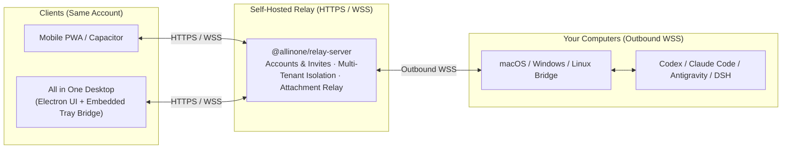

# All in One

<p align="center">
  <a href="./README.md">中文</a> · <strong>English</strong>
</p>

<p align="center">
  <a href="https://github.com/RainbowLion0320/AllinOne/releases/latest"></a>
  <a href="./LICENSE"></a>
  
  <a href="https://github.com/RainbowLion0320/AllinOne/actions/workflows/ci.yml"></a>
</p>

Continue your local **Codex, Claude Code, Antigravity, and DeepSeek Harness** conversations from your phone or any other computer.

All in One runs a lightweight relay on your own server and connects directly to each agent's official local interface, reusing your local workspaces, session history, and vendor prompt caches. Sign in with the same account across devices to discover and switch between all of your online computers automatically.

---

## Quick Start

### 1. Install the Client (You Have a Server URL & Invite Code)

#### Desktop

1. Download and install from [**GitHub Releases**](https://github.com/RainbowLion0320/AllinOne/releases/latest):
   - **macOS (Apple Silicon)**: `All.in.One-*-arm64.dmg`
   - **Windows (x64)**: `All.in.One.Setup.*.exe`
2. Open **All in One**, enter your server URL, and register with your invite code or sign in.
3. Once signed in, the app binds this computer to your account, stays connected in the system tray, and detects your installed AI coding tools (automatically installing missing official CLI companions when a desktop app or session store is already present).

> [!NOTE]
> **First-launch OS security prompts (community builds are not commercially notarized):**
> - **macOS**: If Gatekeeper warns that the app cannot be verified or is "damaged", click **Cancel** and allow it in **System Settings → Privacy & Security → Open Anyway**, or run once in Terminal:
>   ```bash
>   xattr -cr "/Applications/All in One.app"
>   ```
> - **Windows**: If SmartScreen appears, click **More info → Run anyway**.

On Linux or headless machines, connect with a single command:
- macOS / Linux: `curl -fsSL https://your-server/setup.sh | bash`
- Windows (PowerShell): `irm https://your-server/setup.ps1 | iex`

#### Mobile

| Mobile Web Direct Access (iOS / Android) | Android APK (Always Latest) |
| :---: | :---: |
| <a href="https://123.206.218.214/dsh/"></a> | <a href="https://github.com/RainbowLion0320/AllinOne/releases/latest/download/All-in-One-Android.apk"></a> |
| [Open Web App](https://123.206.218.214/dsh/) | [Download Latest APK](https://github.com/RainbowLion0320/AllinOne/releases/latest/download/All-in-One-Android.apk) |

- **iOS / Universal Web**: Scan the QR code or open the web app in your mobile browser and tap **Add to Home Screen** to install as a PWA. Sign in with the same account to access all of your online computers.
- **Android**: Scan to download and install `All-in-One-Android.apk` (auto hot-updates the web UI), or download from [**GitHub Releases**](https://github.com/RainbowLion0320/AllinOne/releases/latest).

> [!TIP]
> **Public Trial Invite Codes (Single-Use, First-Come First-Served)**
>
> Want to try it immediately? Connect to the trial relay `https://123.206.218.214/dsh/` (trusted Let's Encrypt HTTPS + mandatory zero-knowledge AES-256-GCM E2EE — the relay server cannot read any of your chats, code, or files) and register with any of the codes below:
>
> `INV-KXRR-6BNB` · `INV-DCMM-3WFY` · `INV-AFCC-SX2F` · `INV-NUER-YGDK` · `INV-3HXE-UGEK`
>
> If all codes are claimed, self-host your own relay in minutes with Docker below or open an Issue to request a fresh code.

---

### 2. Self-Host the Relay Server (Docker)

Deploy the relay on your own Linux server:

```bash
# 1. Clone the repository
git clone https://github.com/RainbowLion0320/AllinOne.git
cd AllinOne

# 2. Replace ai.yourdomain.com in deploy/Caddyfile with your domain (DNS pointed to this server)

# 3. Create deploy/.env with strong random secrets
cat > deploy/.env <<'EOF'
JWT_SECRET=replace-with-32-plus-char-random-secret
PUBLIC_RELAY_URL=https://ai.yourdomain.com
VITE_RELAY_URL=https://ai.yourdomain.com
EOF

# 4. Build and start (includes Caddy for automatic HTTPS)
cd deploy
docker compose --env-file .env up -d --build

# 5. Create your first admin invite code
docker exec allinone-relay node packages/relay-server/src/admin-cli.js invite create --count 1 --admin --note "owner"
docker compose restart allinone-relay
```

Then follow **1. Install the Client** above to register your admin account. Additional single-use invite codes can be created and revoked directly inside the app UI, and admins can visit **`https://your-server/admin`** (or open **Settings → Server Monitoring Dashboard** in the app) to inspect online users, computer bridges, connected terminals, and a live server resource snapshot on demand (zero extra processes or background polling overhead).

<details>
<summary>Optional: Enable free email binding & self-service password reset (SMTP / Resend)</summary>

Add any standard SMTP credentials (such as Gmail, QQ Mail, or 163 Mail on TLS port 465) to `deploy/.env` and restart the relay to enable optional email binding during signup, email login, post-login email binding, and forgot-password reset:

```env
SMTP_HOST=smtp.gmail.com
SMTP_PORT=465
SMTP_SECURE=true
SMTP_USER=your-email@gmail.com
SMTP_PASS=your-app-password
SMTP_FROM=All in One <your-email@gmail.com>
```

> Resend HTTPS API (`RESEND_API_KEY` + `RESEND_FROM`) is also supported. When omitted, accounts work with username + password + invite code.

</details>

<details>
<summary>Common admin CLI commands</summary>

```bash
npm run admin -- invite create --count 3 --note "for friend"
npm run admin -- invite list
npm run admin -- invite revoke INV-XXXX-XXXX
npm run admin -- users
```

</details>

---

## Supported Agents

| Agent | Integration | Capabilities | Notes |
| :--- | :--- | :--- | :--- |
| **Codex** | `codex app-server --stdio` | Read/write sessions, model & reasoning switching, interrupt | Auto-discovers PATH & macOS `ChatGPT.app` bundled CLI |
| **Claude Code** | `claude -p --resume --output-format stream-json` | Read/write `~/.claude/projects/` sessions, model switching, interrupt | Reuses local login |
| **Antigravity** | `agy acp --app-data-dir antigravity` | Shared desktop history & auth, model & effort switching, background tasks | Syncs Desktop updates live to All in One; after sending turns remotely to an already-open Desktop thread, restart `Antigravity.app` before resuming that thread natively |
| **DeepSeek Harness** | Auto-installed local IPC plugin (`allinone-dsh-ipc`) / native plugin (`dsh-mobile-hub`) | Out-of-the-box read/write & model switching while DSH Desktop is running; read-only history fallback when DSH is closed | Zero-terminal auto-install when `~/.dsh/profiles/desktop` is detected (set `ALLINONE_NO_AUTOFIX=1` to disable) |

- **Multi-Device Control**: Sign in with the same account on phones and desktops to operate any of your online computers.
- **Zero-Knowledge End-to-End Encryption (E2EE)**: Each desktop bridge automatically generates a random 256-bit key (stored in OS Keychain / DPAPI). All prompts, streaming replies, attachments, and local image previews are encrypted with `AES-256-GCM` end-to-end so the relay server only forwards opaque ciphertext; sync new phones via offline QR scan.
- **Single-Use Invites**: Issue `INV-XXXX-XXXX` codes on demand with strict per-account isolation.
- **Native Sessions**: Uses each agent's local storage and official protocol directly so context and prompt caches carry over seamlessly.

---

## Architecture



---

## Developer Guide

> Building from source requires **Node.js >= 22.13.0**.

<details>
<summary>1. Local development</summary>

```bash
git clone https://github.com/RainbowLion0320/AllinOne.git
cd AllinOne
npm install
npm run build
npm run admin -- invite create --count 1 --admin --note "dev"
npm run start:relay
# In a second terminal:
npm run dev:desktop
```

</details>

<details>
<summary>2. Build custom installers with your server URL pre-filled</summary>

```bash
cat > .env.local <<'EOF'
PUBLIC_RELAY_URL=https://ai.yourdomain.com
VITE_RELAY_URL=https://ai.yourdomain.com
EOF

npm run pack:mac   # packages/desktop-app/release/*.dmg
npm run pack:win   # packages/desktop-app/release/*.exe (run on Windows)
```

You can also run **Actions → Build Desktop Installers → Run workflow** on your fork with a custom `relay_url`.

</details>

<details>
<summary>3. Capacitor Android shell, DeepSeek Harness plugin & environment variables</summary>

- **Capacitor Android shell**: Update `server.url` in `packages/mobile-app/capacitor.config.json` to your HTTPS URL, then run:
  ```bash
  cd packages/mobile-app
  npm run build
  npx cap add android   # first-time Android project setup
  npx cap sync android
  npx cap open android
  ```
- **DeepSeek Harness local IPC & manual plugin mode**: When All in One Desktop / PC Bridge detects DeepSeek Harness (`~/.dsh/profiles/desktop`), it automatically installs the zero-dependency loopback IPC plugin `allinone-dsh-ipc` (`127.0.0.1` + 256-bit Bearer token) so read/write and model switching work out of the box with zero terminal setup while DSH Desktop is running. For advanced manual integration with the full `dsh-mobile-hub` plugin, copy `packages/dsh-mobile-hub/cordis.patch.example.yml` to `cordis.patch.yml`, link `dsh-mobile-hub` in `~/.dsh/profiles/desktop/package.json` under `dsh.profile.bundles`, and restart DSH.
- **Disable background CLI completion & DSH local IPC auto-install**: Set `ALLINONE_NO_AUTOFIX=1`.

</details>

<details>
<summary>4. Repository layout & smoke tests</summary>

```text
AllinOne/
├── packages/
│   ├── shared/          # Shared protocol, E2EE & offline QR SVG (protocol.js, e2ee.js, qr-svg.js)
│   ├── relay-server/    # Relay gateway, account/invite store, /admin dashboard & static hosting
│   ├── dsh-mobile-hub/  # 4 AI agent adapters, CLI auto-completion & portable bridge CLI
│   ├── mobile-app/      # React + Tailwind + Vite PWA frontend
│   └── desktop-app/     # Electron desktop app & DMG/NSIS installer packaging
├── deploy/              # Dockerfile / docker-compose.yml / Caddyfile / nginx.conf
├── scripts/             # Portable bridge bundler & end-to-end smoke test suite
└── .github/workflows/   # CI checks & desktop release workflows
```

Run end-to-end smoke & security tests:
```bash
npm run test:smoke
```

</details>

---

## Security, Contributing & License

Please review [SECURITY.md](./SECURITY.md) before deploying:

- **Self-Host Over HTTPS/WSS**: Traffic uses TLS and the relay routes messages and temporary attachments, so connect only to a server you control.
- **Permissions**: Adapters default to autonomous approval/edit presets for remote usability; see [SECURITY.md](./SECURITY.md) to tighten them.
- **Notice**: Independent open-source project; affiliated with none of DeepSeek, OpenAI, Anthropic, or Google.
- **Contributing & License**: See [CONTRIBUTING.md](./CONTRIBUTING.md) · Licensed under [MIT](./LICENSE).
