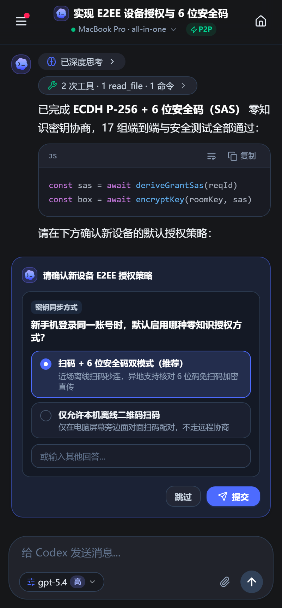
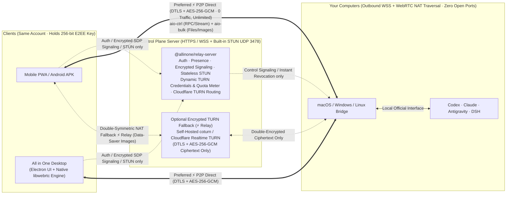

<div align="center">


<h1>All in One</h1>

<p>
  <strong>End-to-End Encrypted Remote Control for Your Local AI Coding Agents</strong><br/>
  Unified workspace for <strong>Codex</strong> · <strong>Claude Code / Desktop</strong> · <strong>Antigravity</strong> · <strong>DeepSeek Harness</strong> · <strong>WorkBuddy</strong>
</p>

<p>
  <a href="./README.md">中文</a> · <strong>English</strong>
</p>

<p>
  <a href="https://github.com/RainbowLion0320/AllinOne/releases/latest"></a>
  
  
  <a href="https://github.com/RainbowLion0320/AllinOne/actions/workflows/ci.yml"></a>
  <a href="./LICENSE"></a>
</p>

<p>
  <a href="#-highlights">Highlights</a> ·
  <a href="#-quick-start">Quick Start</a> ·
  <a href="#-supported-agents">Supported Agents</a> ·
  <a href="#-security--architecture">Security &amp; Architecture</a> ·
  <a href="#-one-click-self-hosting-docker">Self-Hosting</a> ·
  <a href="#-developer-guide">Developer Guide</a>
</p>

</div>

---

## Preview

<table>
  <tr>
    <td width="72%" align="center" valign="bottom">
      
      <br/>
      <sub><strong>Desktop / Web</strong> — Unified 4-agent sidebar, border-integrated weekly quota rings, project tree &amp; interactive Q&amp;A cards</sub>
    </td>
    <td width="28%" align="center" valign="bottom">
      
      <br/>
      <sub><strong>Mobile PWA / Android</strong> — Continue chats, inspect code &amp; resolve prompts anywhere</sub>
    </td>
  </tr>
</table>

> All in One runs a **Pure Control Plane + Direct WebRTC P2P-First (`AIO-P2P v1`) + Optional Encrypted TURN Fallback** architecture: your server handles only authentication, device presence, encrypted signaling, and a built-in stateless STUN server (`UDP 3478`), with zero control-plane payload relay or temporary file storage. Under typical networks, phone and computer connect via **`⚡ P2P` direct peer-to-peer (0 bytes through your server, permanently unlimited)**; behind strict double-symmetric NATs, connections seamlessly fall back to encrypted **`⚡ Relay`** (optional self-hosted `coturn` or tiered Cloudflare Realtime TURN — still strictly DTLS + AES-256-GCM ciphertext-only) while preserving your local workspaces, session history, and vendor prompt caches.

---

## ✨ Highlights

<table>
  <tr>
    <td width="50%" valign="top">
      <h4>🧩 4 AI Coding Agents, One Interface</h4>
      <p>Control your local <strong>Codex</strong>, <strong>Claude Code / Desktop</strong>, <strong>Antigravity</strong>, and <strong>DeepSeek Harness</strong> sessions grouped by project or time from a single unified UI.</p>
    </td>
    <td width="50%" valign="top">
      <h4>⚡ Direct WebRTC P2P First + Optional Encrypted TURN</h4>
      <p>Defaults to <strong><code>⚡ P2P</code> direct DataChannels</strong> (<code>AES-256-GCM</code> + DTLS, <strong>0 bytes of server traffic, permanently unlimited</strong>) with built-in RFC 5389 STUN (<code>UDP 3478</code>); automatically falls back to encrypted <strong><code>⚡ Relay</code></strong> on double-symmetric NATs (optional self-hosted <code>coturn</code> with 4-tier monthly quotas or tiered Cloudflare Realtime TURN's free 1 TB/mo pool) with automatic <strong>Relay Data-Saver</strong> (tap-to-load images).</p>
    </td>
  </tr>
  <tr>
    <td width="50%" valign="top">
      <h4>🔒 Mandatory Zero-Knowledge E2EE</h4>
      <p>WebRTC signaling, RPCs, streaming output, and bulk files are all encrypted with your local 256-bit room key; sync new devices via offline QR or <strong>ECDH P-256 + 6-digit SAS</strong>.</p>
    </td>
    <td width="50%" valign="top">
      <h4>📊 Interactive Q&amp;A, Sync &amp; Weekly Quotas</h4>
      <p>Resolve agent prompts on mobile (including Codex <code>turn/steer</code> and bidirectional DSH dismissal) and monitor Codex / Claude / Antigravity weekly quotas via border-integrated progress rings.</p>
    </td>
  </tr>
  <tr>
    <td width="50%" valign="top">
      <h4>📱 Cross-Platform Multi-Machine Control</h4>
      <p>Native macOS / Windows desktop apps (using built-in Chromium <code>libwebrtc</code> + tray bridge), pure-JS Linux one-line CLI, iOS / Android PWA, and Android APK.</p>
    </td>
    <td width="50%" valign="top">
      <h4>🐳 Featherweight Self-Hosting, MIT Open Source</h4>
      <p>With zero control-plane payload relay or temp file storage, even a tiny 1-vCPU VPS runs effortlessly via one <code>docker compose</code> command (auto HTTPS + built-in STUN + optional <code>coturn</code> / Cloudflare TURN) plus an on-demand <code>/admin</code> dashboard.</p>
    </td>
  </tr>
</table>

---

## 🚀 Quick Start

> [!TIP]
> **Public Trial Relay (Open Self-Registration)**
>
> Want to try All in One right now? Open the web app or desktop client, set the server URL to **`https://123.206.218.214/dsh/`** (trusted Let's Encrypt HTTPS + mandatory zero-knowledge `AES-256-GCM` E2EE — the relay server cannot read any of your chats, code, or files), and **directly register your own account**.
>
> To prevent automated sign-up abuse, the server enforces a default daily cap of **20 new accounts/day** (`MAX_DAILY_REGISTRATIONS=20`). If today's cap is reached, it resets automatically the next day — or spin up your own private relay in one minute with [One-Click Self-Hosting](#-one-click-self-hosting-docker).

### Up and Running in 3 Steps

1. **Install on Your Computer**: Download the Desktop app (or run the one-line CLI script), enter your server URL, and register / sign in to bind your machine and keep the tray bridge online.
2. **Open on Your Phone**: Scan the QR code to open the Mobile Web app (iOS: **Add to Home Screen**) or install the Android APK, then sign in with the **same account**.
3. **Sync Your E2EE Key**: On a new phone, scan the offline QR code on your computer or verify the **6-digit security code (SAS)** to transfer your 256-bit room key with zero server visibility.

### Desktop Download

Download from [**GitHub Releases**](https://github.com/RainbowLion0320/AllinOne/releases/latest):

- **macOS (Apple Silicon)**: `All.in.One-*-arm64.dmg`
- **Windows (x64)**: `All.in.One.Setup.*.exe`

After signing in, the app automatically detects installed AI coding tools (and installs missing official CLI companions when a desktop app or session store is already present; set `ALLINONE_NO_AUTOFIX=1` to disable).

<details>
<summary>First-launch macOS / Windows OS prompts (community builds are not commercially notarized)</summary>

- **macOS**: If Gatekeeper warns that the app cannot be verified or is "damaged", click **Cancel** and allow it in **System Settings → Privacy & Security → Open Anyway**, or run once in Terminal:
  ```bash
  xattr -cr "/Applications/All in One.app"
  ```
- **Windows**: If SmartScreen appears, click **More info → Run anyway**.

</details>

On Linux or headless machines, connect with a single command:

```bash
# macOS / Linux
curl -fsSL https://your-server/setup.sh | bash

# Windows (PowerShell)
irm https://your-server/setup.ps1 | iex
```

### Mobile Quick Access

| Mobile Web Direct Access (iOS / Android) | Android APK (Always Latest) |
| :---: | :---: |
| <a href="https://123.206.218.214/dsh/"></a> | <a href="https://github.com/RainbowLion0320/AllinOne/releases/latest/download/All-in-One-Android.apk"></a> |
| [Open Web App](https://123.206.218.214/dsh/) · iOS: Tap **Add to Home Screen** | [Download Latest APK](https://github.com/RainbowLion0320/AllinOne/releases/latest/download/All-in-One-Android.apk) · Auto hot-updates UI |

---

## 🤖 Supported Agents

| Agent | Local Integration | Capabilities | Highlights & Notes |
| :--- | :--- | :--- | :--- |
| **Codex** | `codex app-server --stdio` | Read/write sessions, model & reasoning switching, async Q&A, mid-turn `turn/steer`, interrupt | Auto-discovers `PATH`, macOS `ChatGPT.app`, and newest Windows Codex Desktop CLI; weekly quota ring supported |
| **Claude Code / Desktop** | `claude -p --resume --output-format stream-json` | Read/write `~/.claude/projects/` sessions, model switching, interrupt, Cowork/Code mirror | Reuses local login; Claude Desktop Cowork threads sync live with a `Desktop` badge; weekly quota ring supported |
| **Antigravity** | `agy acp --app-data-dir antigravity` | Shared desktop history & auth, model & effort switching, background task sync | Live Desktop sync + Gemini weekly quota ring; after sending remote turns to an already-open Desktop thread, restart `Antigravity.app` before resuming natively |
| **DeepSeek Harness** | Auto-installed loopback IPC (`allinone-dsh-ipc`) / native plugin (`dsh-mobile-hub`) | Read/write, model switching, bidirectional prompt sync; read-only history fallback when DSH is closed | Zero-terminal auto-install when `~/.dsh/profiles/desktop` is detected (`127.0.0.1` + 256-bit token); answering remotely dismisses DSH Desktop prompt cards automatically |
| **WorkBuddy** | `~/.workbuddy` live sync + silent official native `codebuddy` CLI auto-install (1-click ACP QR sign-in) | Zero-config live sync of WorkBuddy Desktop sessions, thinking, tool calls & workspaces; 1-click UI sign-in (zero terminal, no Node.js required) unlocks remote sending, resume & model switching | Shares the same Tencent account & Credits quota as WorkBuddy Desktop; mirrors live with a `Desktop` badge until authorized once, then stays `RW` permanently |

---

## 🛡️ Security & Architecture

All in One is built around **6 layers of zero-knowledge defense-in-depth** — even a compromised or third-party-hosted relay cannot inspect or tamper with your conversations, source code, or local files:

| Layer | Mechanism | Guarantee |
| :--- | :--- | :--- |
| **1. Mandatory E2EE** | `AES-256-GCM` + 256-bit room key + AAD bound to room & message type | All chats, tool calls, attachments, local images & quotas are encrypted client-side; bridges reject plaintext RPCs with anti-replay IV tracking |
| **2. Pure Control Plane + P2P First / Encrypted TURN** | No control-plane data relay or `/api/uploads` storage — only auth, encrypted WebRTC signaling, stateless STUN (`UDP 3478`) & optional short-lived TURN credentials | Direct **`⚡ P2P`** carries 0 server traffic (permanently unlimited); double-symmetric NATs optionally fall back to encrypted **`⚡ Relay`** (self-hosted `coturn` 4-tier monthly quotas `free` 1 GB / `pro` 10 GB / `ultra` 50 GB / `admin` 50 GB, or tiered Cloudflare TURN) — still strictly DTLS + AES-256-GCM ciphertext-only with Relay Data-Saver tap-to-load images |
| **3. Zero-Knowledge Device Grant** | Offline QR scan **or** `ECDH P-256` + `HKDF-SHA256` + **6-digit SAS** | Remote key sync derives an independent 6-digit verification code on both devices to prevent MITM attacks |
| **4. Zero Open Inbound Ports** | PC bridges initiate **outbound WSS** control + **STUN UDP traversal** only | No router port forwarding, no public SSH/daemon exposure on your home or office machine |
| **5. OS Hardware Key Storage** | macOS Keychain / Windows DPAPI (Electron `safeStorage`) | 256-bit E2EE keys are encrypted by your OS credential vault instead of plaintext files |
| **6. Registration Guard & Instant P2P Revocation** | Atomic daily registration cap (default 20/day) + optional `ADMIN_BOOTSTRAP_TOKEN` + optional Email 2FA + one-time WS tickets + live `client.revoked` push | Prevents bulk sign-up abuse; revoking any lost device immediately instructs PC bridges to tear down its P2P DataChannels in milliseconds (verified by 38 automated security & P2P/TURN test suites) |

### Architecture



---

## 🐳 One-Click Self-Hosting (Docker)

Deploy your own private zero-knowledge relay on any Linux server (`amd64` / `arm64`) with **one command** — pulls the prebuilt multi-arch `ghcr.io` image automatically with zero local compilation:

```bash
curl -fsSL https://raw.githubusercontent.com/RainbowLion0320/AllinOne/main/deploy/install.sh | bash
```

The interactive wizard finishes everything in under a minute:
- **3 Deployment Modes**: ① Custom Domain + automatic Let's Encrypt HTTPS via Caddy (Recommended) · ② **Bare Public IP + trusted Let's Encrypt IP HTTPS** (no domain required) · ③ Control Plane Container Only (binds `127.0.0.1:8787` for existing Nginx / Caddy / Cloudflare Tunnel setups).
- **Built-In Stateless STUN (`UDP 3478`) + Optional Encrypted TURN**: The container exposes **`UDP 3478`** for zero-dependency RFC 5389 NAT discovery (open `UDP 3478` in your cloud firewall / security group). Direct **`⚡ P2P`** stays at 0 server traffic permanently; for strict double-symmetric NATs, optionally enable self-hosted `coturn` (with 4-tier monthly quotas) or Cloudflare Realtime TURN's free 1 TB/mo pool via `.env`.
- **Secure Defaults**: Automatically generates a 256-bit `JWT_SECRET` (`chmod 600 .env`) with an optional Email 2FA / SMTP wizard (Gmail, QQ Mail, 163 Mail, or custom SMTP).
- **Open Registration & First-Admin Bootstrap**: Runs a health check and is immediately ready for sign-up — the first user registered on a brand-new server automatically becomes **Admin** (optionally guarded by `ADMIN_BOOTSTRAP_TOKEN`), while subsequent users can openly self-register under the built-in daily cap (`MAX_DAILY_REGISTRATIONS=20` by default, `0` = unlimited). Supports zero-downtime upgrades via `--upgrade`.

```bash
# Non-interactive examples (great for automation / cloud-init)
curl -fsSL https://raw.githubusercontent.com/RainbowLion0320/AllinOne/main/deploy/install.sh | bash -s -- --domain ai.yourdomain.com --yes
curl -fsSL https://raw.githubusercontent.com/RainbowLion0320/AllinOne/main/deploy/install.sh | bash -s -- --upgrade
```

After registering your admin account, open **`https://your-server/admin`** (or **Settings → Server Monitoring Dashboard**) to inspect online users, PC bridges, client terminals, daily sign-up stats, and live server health — and manage users and tiers (`free` / `pro` / `ultra` / `admin`) on demand with zero background polling overhead.

<details>
<summary>Manual Docker Compose deployment (or build from source)</summary>

```bash
# 1. Clone the repository
git clone https://github.com/RainbowLion0320/AllinOne.git
cd AllinOne

# 2. Replace ai.yourdomain.com in deploy/Caddyfile with your domain (DNS pointed to this server)

# 3. Create deploy/.env with strong random secrets (32+ chars)
cat > deploy/.env <<'EOF'
JWT_SECRET=replace-with-32-plus-char-random-secret
PUBLIC_RELAY_URL=https://ai.yourdomain.com
VITE_RELAY_URL=https://ai.yourdomain.com
MAX_DAILY_REGISTRATIONS=20
# Optional: require a bootstrap secret to register the first Admin on a brand-new server
# ADMIN_BOOTSTRAP_TOKEN=replace-with-strong-bootstrap-secret
EOF

# 4. Pull the prebuilt ghcr.io image and start (or add --build to compile from source)
cd deploy
docker compose --env-file .env pull
docker compose --env-file .env up -d

# 5. Open https://ai.yourdomain.com to register the first account (automatically becomes Admin),
#    then manage users, tiers, and live metrics at https://ai.yourdomain.com/admin
```

</details>

<details>
<summary>Optional: Enable free Email 2FA & self-service password reset (SMTP / Resend)</summary>

Add any standard SMTP credentials (Gmail, QQ Mail, 163 Mail on TLS port 465) to `deploy/.env` and restart the relay to enable email binding, login email 2FA verification, email changes, and forgot-password reset:

```env
SMTP_HOST=smtp.gmail.com
SMTP_PORT=465
SMTP_SECURE=true
SMTP_USER=your-email@gmail.com
SMTP_PASS=your-app-password
SMTP_FROM=All in One <your-email@gmail.com>
```

> Resend HTTPS API (`RESEND_API_KEY` + `RESEND_FROM`) is also supported. When omitted, accounts work with username + password self-registration (guarded by `MAX_DAILY_REGISTRATIONS`).

</details>

<details>
<summary>Optional: Configure encrypted TURN fallback (self-hosted coturn 4-tier quotas / Cloudflare Realtime TURN 1 TB free pool)</summary>

Direct **`⚡ P2P`** connections always use **0 server traffic and are permanently unlimited**. Encrypted **`⚡ Relay`** is only engaged when both peers sit behind strict symmetric NATs — TURN nodes only ever see DTLS + `AES-256-GCM` ciphertext, and clients automatically enable **Relay Data-Saver** (tap-to-load images).

1. **Self-hosted `coturn` dynamic credentials & 4-tier monthly quotas** (add to `deploy/.env`; if co-hosting `coturn` on host `UDP 3478`, set `STUN_PORT=off` and comment out the `3478/udp` mapping in `docker-compose.yml`):
   ```env
   STUN_PORT=off
   TURN_HOST=ai.yourdomain.com
   TURN_PORT=3478
   TURN_SECRET=strong-random-secret-matching-coturn-static-auth-secret
   TURN_TTL_SEC=600
   # Optional: bind-mount /var/log/coturn/turn.log:ro to enforce per-user monthly quotas
   TURN_LOG_FILE=/var/log/coturn/turn.log
   TURN_QUOTA_FREE_MB=1024      # free: 1 GB/month (0 = unlimited)
   TURN_QUOTA_PRO_MB=10240      # pro: 10 GB/month
   TURN_QUOTA_ULTRA_MB=51200    # ultra / admin: 50 GB/month (admin strictly matches ultra)
   ```
2. **Optional tiered Cloudflare Realtime TURN (1 TB/month free pool)**:
   ```env
   CF_TURN_TOKEN_ID=your-cloudflare-turn-token-id
   CF_TURN_API_TOKEN=your-cloudflare-turn-api-token
   CF_TURN_TIERS=free           # defaults to routing free tier to Cloudflare 1 TB pool; pro/ultra/admin use self-hosted coturn
   CF_TURN_TTL_SEC=3600
   ```
   > If the Cloudflare API is unconfigured or temporarily unreachable, the control plane gracefully falls back to self-hosted `coturn` / STUN without blocking connections.

</details>

<details>
<summary>Common admin CLI commands &amp; registration env vars</summary>

```bash
# List registered users, roles, and quota tiers
npm run admin -- users

# Update a user's quota tier / admin role (free | pro | ultra | admin)
npm run admin -- user tier <username-or-id> <free|pro|ultra|admin>
```

Registration &amp; bootstrap environment variables (add to `.env` and restart):
- `MAX_DAILY_REGISTRATIONS=20`: Server-side daily cap on new self-registered accounts (default `20`, set `0` for unlimited).
- `ADMIN_BOOTSTRAP_TOKEN`: Optional secret required to register the first Admin account on a brand-new server; when unset, the first registered user automatically becomes Admin.

</details>

---

## 🛠️ Developer Guide

> Building from source requires **Node.js >= 22.13.0**.

<details>
<summary>1. Local development</summary>

```bash
git clone https://github.com/RainbowLion0320/AllinOne.git
cd AllinOne
npm install
npm run build
npm run start:relay
# Open http://127.0.0.1:8787 and register the first account (automatically becomes Admin)
# In a second terminal:
npm run dev:desktop
```

</details>

<details>
<summary>2. Build custom installers with your server URL pre-filled</summary>

```bash
cat > .env.local <<'EOF'
PUBLIC_RELAY_URL=https://ai.yourdomain.com
VITE_RELAY_URL=https://ai.yourdomain.com
EOF

npm run pack:mac   # packages/desktop-app/release/*.dmg
npm run pack:win   # packages/desktop-app/release/*.exe (run on Windows)
```

You can also run **Actions → Build Desktop Installers → Run workflow** on your fork with a custom `relay_url`.

</details>

<details>
<summary>3. Capacitor Android shell, DeepSeek Harness plugin &amp; environment variables</summary>

- **Capacitor Android shell**: Update `server.url` in `packages/mobile-app/capacitor.config.json` to your HTTPS URL, then run:
  ```bash
  cd packages/mobile-app
  npm run build
  npx cap add android   # first-time Android project setup
  npx cap sync android
  npx cap open android
  ```
- **DeepSeek Harness local IPC & manual plugin mode**: When All in One Desktop / PC Bridge detects DeepSeek Harness (`~/.dsh/profiles/desktop`), it automatically installs the zero-dependency loopback IPC plugin `allinone-dsh-ipc` (`127.0.0.1` + 256-bit Bearer token) so read/write and model switching work out of the box with zero terminal setup while DSH Desktop is running. For advanced manual integration with the full `dsh-mobile-hub` plugin, copy `packages/dsh-mobile-hub/cordis.patch.example.yml` to `cordis.patch.yml`, link `dsh-mobile-hub` in `~/.dsh/profiles/desktop/package.json` under `dsh.profile.bundles`, and restart DSH.
- **Disable background CLI completion & DSH local IPC auto-install**: Set `ALLINONE_NO_AUTOFIX=1`.

</details>

<details>
<summary>4. Repository layout &amp; automated security smoke tests</summary>

```text
AllinOne/
├── packages/
│   ├── shared/          # Shared protocol, AES-256-GCM / ECDH E2EE, P2P mux (p2p-mux.js) & offline QR SVG
│   ├── relay-server/    # Pure Control Plane, built-in STUN, dynamic TURN / 4-tier quota meter, Cloudflare TURN, /admin & static hosting
│   ├── dsh-mobile-hub/  # 4 AI agent adapters, WebRTC P2P (werift), weekly quota collector, CLI autofix & portable bridge
│   ├── mobile-app/      # React + Tailwind + Vite PWA frontend (WebRTC P2P & Relay Data-Saver)
│   └── desktop-app/     # Electron desktop app, native libwebrtc worker (webrtc-proxy.js), OS keychain & DMG/NSIS packaging
├── deploy/              # Dockerfile / docker-compose.yml / Caddyfile / nginx.conf / install.sh
├── scripts/             # Portable bridge bundler & 38-suite E2E smoke + security test suite
└── .github/workflows/   # CI checks, GHCR Docker publish & multi-platform release workflows
```

Run the full end-to-end smoke & security test suite:

```bash
npm run test:smoke
```

</details>

---

## 📄 Security, Contributing & License

- **Security**: Please review [SECURITY.md](./SECURITY.md) before deploying. Adapters default to autonomous approval/edit presets for remote usability and can be tightened per [SECURITY.md](./SECURITY.md); connect only to a trusted HTTPS/WSS relay.
- **Notice**: Independent open-source project; not affiliated with DeepSeek, OpenAI, Anthropic, or Google.
- **Contributing & License**: Contributions welcome via Issues & PRs ([CONTRIBUTING.md](./CONTRIBUTING.md)) · Licensed under [MIT](./LICENSE).
